# MySharpVenture · fuentes de diagramas · SDD 1.0

Los PNG del documento principal permiten consultar los gráficos sin un complemento de diagramación. Cada fuente se entrega también como archivo `.mmd`. Los casos de uso utilizan la sintaxis `usecase-beta` de Mermaid 12; su imagen es la alternativa para lectores que no la admiten.

## 01-estados

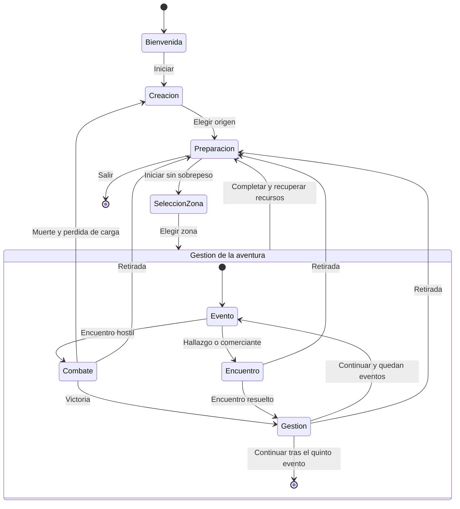

## 02-turnos

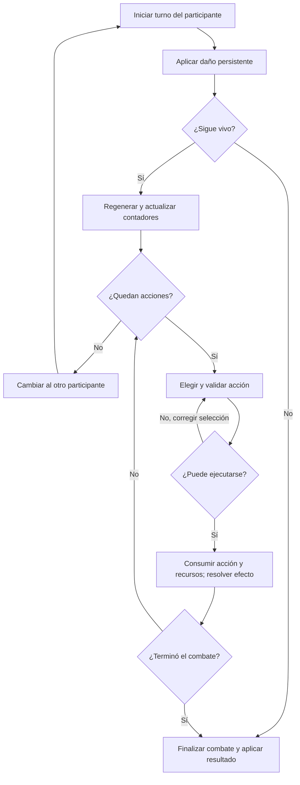

## 03-arquitectura

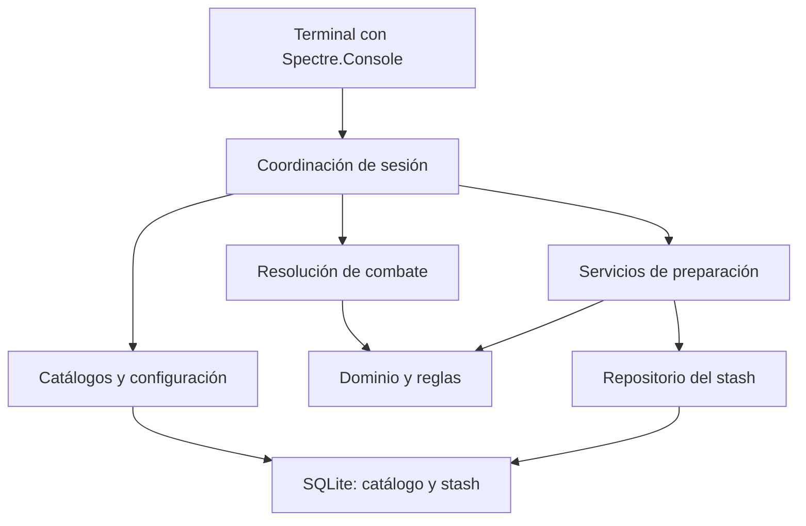

## 04-clases-entidades

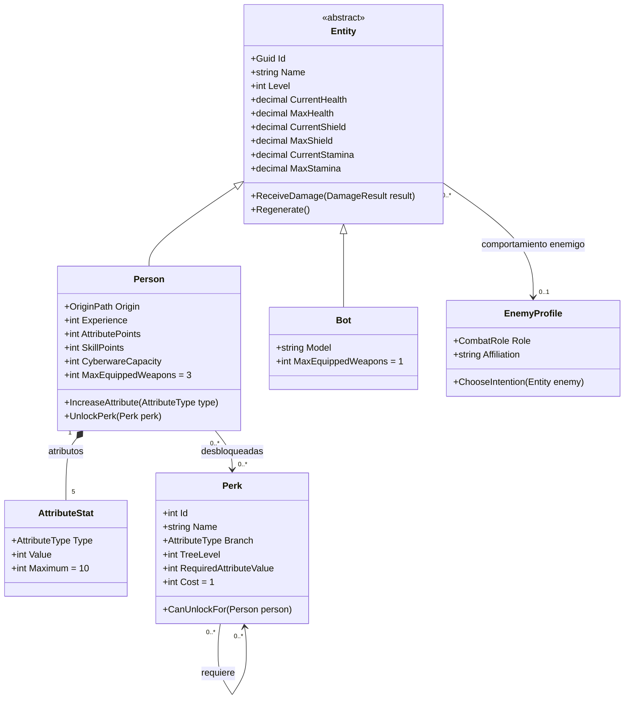

## 05-clases-objetos

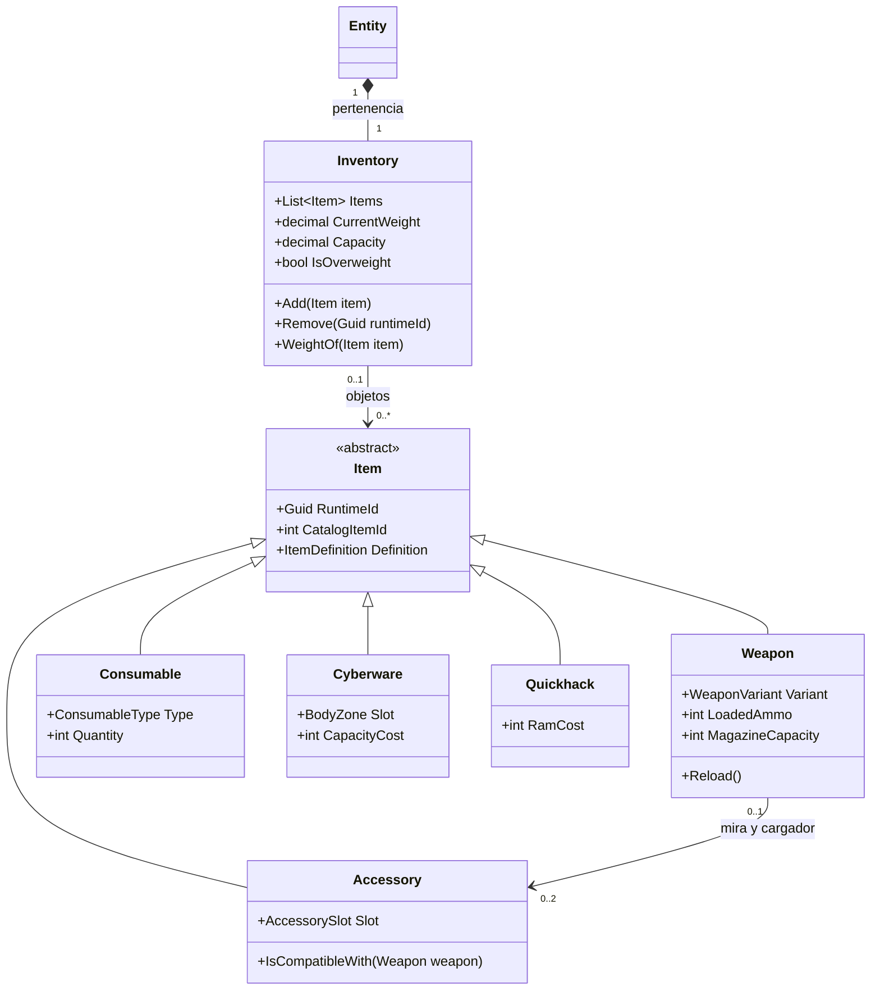

## 06-clases-equipo

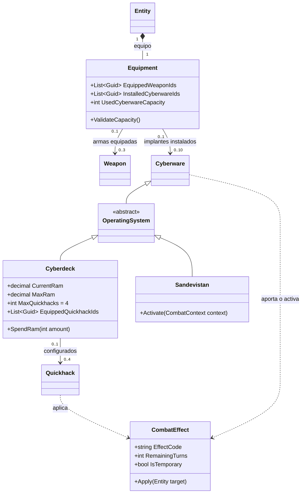

## 07-clases-sesion

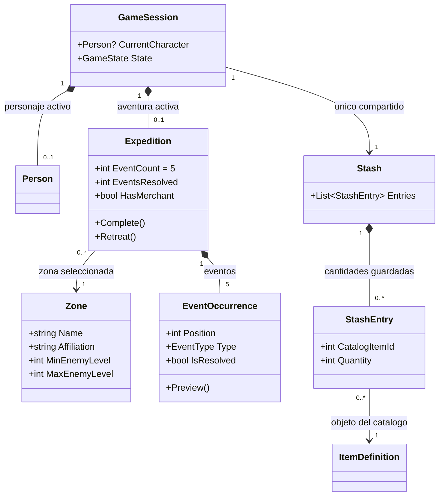

## 08-clases-persistencia

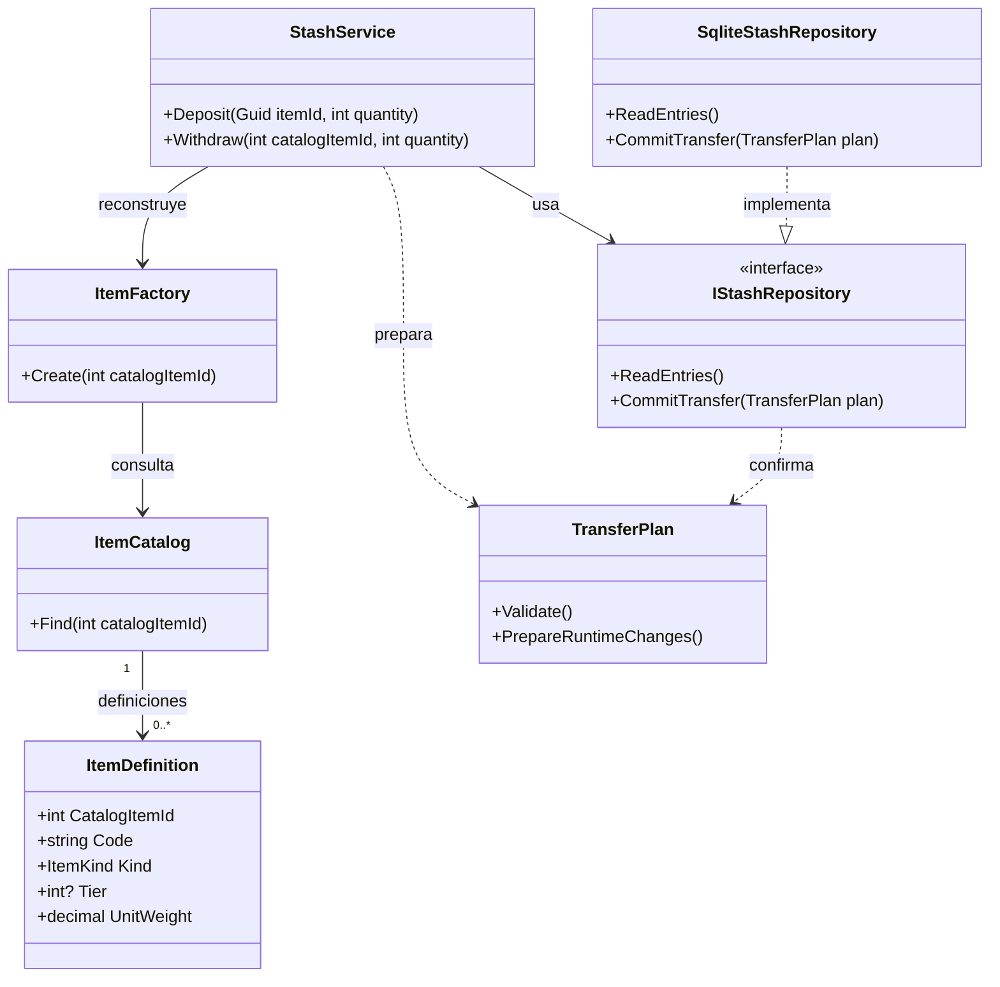

## 09-bd-nucleo

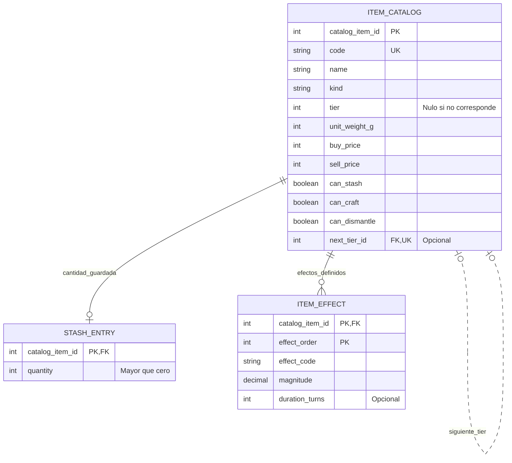

## 10-bd-armas

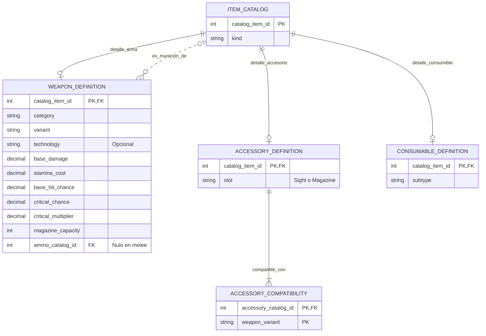

## 11-bd-cyberware

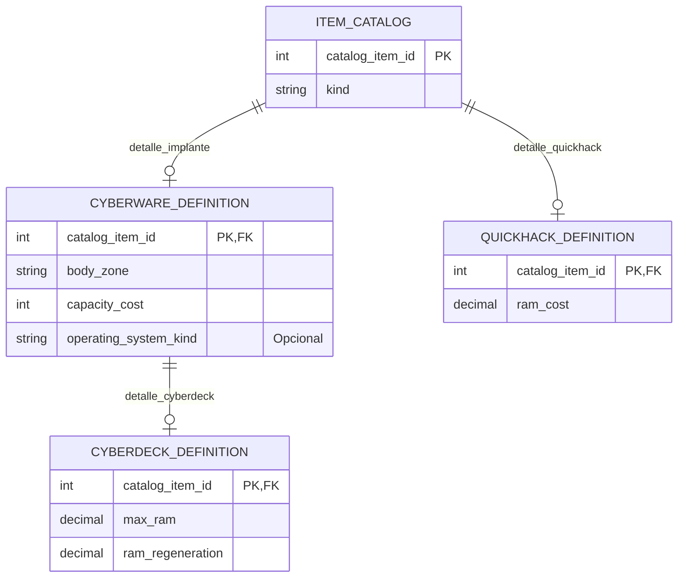

## 12-bd-mvp

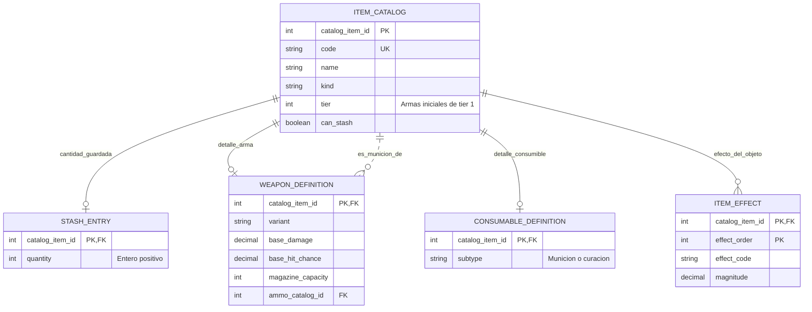

## 13-casos-uso-mvp

```text
usecase-beta
direction LR
actor Jugador("Jugador")
systemBoundary sistema["MySharpVenture - MVP"]
    CU05("CU05 Crear personaje")
    CU07("CU07 Gestionar inventario y equipo")
    CU03("CU03 Gestionar stash")
    CU01("CU01 Completar aventura")
    CU02("CU02 Resolver combate")
    CU15("CU15 Recoger botín")
    CU08("CU08 Utilizar curación")
    CU14("CU14 Salir del juego")
end
Jugador -- CU05
Jugador -- CU07
Jugador -- CU03
Jugador -- CU01
Jugador -- CU02
Jugador -- CU15
Jugador -- CU08
Jugador -- CU14
CU02 ..> : extend CU01
CU15 ..> : extend CU01
```

## 14-casos-uso-aventura

```text
usecase-beta
direction LR
actor Jugador("Jugador")
systemBoundary sistema["MySharpVenture - sesión y aventura"]
    CU05("CU05 Crear personaje")
    CU01("CU01 Completar aventura")
    CU02("CU02 Resolver combate")
    CU15("CU15 Recoger botín")
    CU13("CU13 Retirarse")
    CU14("CU14 Salir del juego")
end
Jugador -- CU05
Jugador -- CU01
Jugador -- CU02
Jugador -- CU15
Jugador -- CU13
Jugador -- CU14
CU02 ..> : extend CU01
CU15 ..> : extend CU01
CU13 ..> : extend CU01
```

## 15-casos-uso-preparacion

```text
usecase-beta
direction LR
actor Jugador("Jugador")
systemBoundary sistema["MySharpVenture - preparación y equipo"]
    CU03("CU03 Gestionar stash")
    CU04("CU04 Mejorar objeto")
    CU06("CU06 Asignar puntos")
    CU07("CU07 Gestionar inventario y equipo")
    CU08("CU08 Utilizar curación")
    CU09("CU09 Comprar o vender")
    CU10("CU10 Visitar ripperdoc")
    CU11("CU11 Fabricar objeto")
    CU12("CU12 Desarmar objeto")
end
Jugador -- CU03
Jugador -- CU04
Jugador -- CU06
Jugador -- CU07
Jugador -- CU08
Jugador -- CU09
Jugador -- CU10
Jugador -- CU11
Jugador -- CU12
```

## 16-gantt

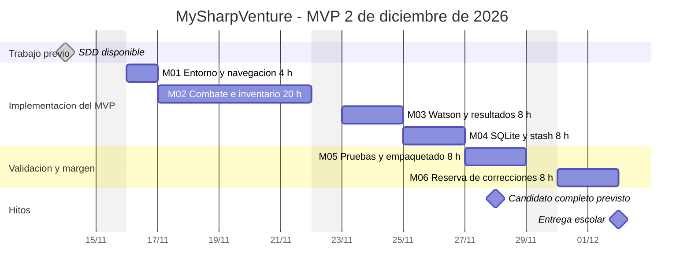

