# Diseño de MySharpVenture

**Documento de diseño de software · versión 1.0**

MySharpVenture es un juego de rol de terminal, inspirado en el universo de Cyberpunk, desarrollado en C# con Spectre.Console. El jugador crea un personaje, prepara su equipo y realiza aventuras de cinco eventos en zonas de dificultad fija. La muerte elimina al personaje y sus pertenencias transportadas; el stash conserva los objetos depositados para personajes posteriores.

| Control | Dato |
|---|---|
| Autor | Raúl Bustamante |
| Materia | Modelos y Sistemas |
| Profesora | Amet Luciana |
| Proyecto | MySharpVenture |
| Versión | 1.0 — primera entrega documental |
| Fecha de emisión | 14 de noviembre de 2026 |
| Finalidad | Aprobación del diseño y delimitación del MVP escolar |
| Primera entrega | Miércoles 2 de diciembre de 2026: MVP jugable |
| Plan del MVP | 16/11–01/12: 56 h disponibles, incluidas 8 h de reserva |
| Estado del proyecto | Prototipo de navegación; desarrollo y validación del MVP planificados |

## Contenido

1. [Propósito y alcance](#1-propósito-y-alcance)
2. [Recorrido del jugador](#2-recorrido-del-jugador)
3. [Personaje y progresión](#3-personaje-y-progresión)
4. [Combate y acciones](#4-combate-y-acciones)
5. [Recursos, efectos y resultados](#5-recursos-efectos-y-resultados)
6. [Inventario y stash](#6-inventario-y-stash)
7. [Armas, munición y accesorios](#7-armas-munición-y-accesorios)
8. [Cyberware y quickhacks](#8-cyberware-y-quickhacks)
9. [Fabricación y economía](#9-fabricación-y-economía)
10. [Arquitectura y diagramas de clases](#10-arquitectura-y-diagramas-de-clases)
11. [Modelo relacional](#11-modelo-relacional)
12. [Requisitos y trazabilidad](#12-requisitos-y-trazabilidad)
13. [Casos de uso](#13-casos-de-uso)
14. [Verificación prevista](#14-verificación-prevista)
15. [Plan de trabajo y Gantt](#15-plan-de-trabajo-y-gantt)
16. [Criterios de diseño y balance](#16-criterios-de-diseño-y-balance)
17. [Fuentes y glosario](#17-fuentes-y-glosario)

**Organización del documento.** La sección 1.3 establece el MVP para el 2 de diciembre de 2026. Las secciones 2–9 especifican el diseño funcional completo e indican el alcance de cada fase. Los requisitos, casos de uso y pruebas identifican qué corresponde al MVP y qué se desarrolla después. Los modelos técnicos describen la estructura del sistema; las pruebas de aceptación se ejecutarán sobre la implementación.

Los diagramas se incluyen como imágenes PNG. El paquete contiene sus versiones SVG y fuentes Mermaid editables. La copia HTML incorpora las imágenes dentro del propio archivo y se puede consultar sin conexión.

## 1. Propósito y alcance

### 1.1 Propósito, público destinatario y justificación

MySharpVenture es un proyecto de entretenimiento sin fines de lucro destinado a **jóvenes interesados en el universo de Cyberpunk**, especialmente a quienes disfrutan del combate por turnos, la preparación de equipo y la repetición de aventuras con diferentes configuraciones. La ambientación utiliza zonas, organizaciones, armas e implantes reconocibles de ese universo para dar identidad a la experiencia.

El juego propone aventuras breves en las que el jugador elige cómo prepararse, administra sus recursos y responde a la intención del enemigo. El sistema por turnos permite evaluar cada acción sin depender de la velocidad de reacción. La variedad de equipo y la selección de eventos favorecen la experimentación y la posibilidad de volver a jugar; el interés se concentra en las decisiones y sus resultados.

La muerte del personaje da importancia al riesgo asumido en cada aventura. El stash permite conservar los objetos depositados y utilizarlos con personajes posteriores, de modo que cada recorrido combina la posibilidad de obtener recompensas con la necesidad de proteger parte de lo conseguido. Este ciclo sostiene la continuidad del juego sin requerir una historia extensa ni un jefe final.

La aplicación funciona de forma individual, local y sin conexión, con una interfaz de terminal en español. El MVP ofrece una experiencia completa en Watson: crear un personaje, equiparlo, resolver cinco eventos, recoger recompensas y regresar o comenzar de nuevo tras morir.

En el ámbito escolar, el proyecto permite aplicar análisis de requisitos, programación orientada a objetos, gestión de estados, persistencia relacional y pruebas. Estos objetivos formativos acompañan su finalidad principal: ofrecer una experiencia de entretenimiento coherente para el público definido.

### 1.2 Condiciones de uso

- Un jugador local, sin cuentas ni perfiles múltiples.
- Funcionamiento sin conexión durante el uso normal.
- Interfaz de terminal en español, mediante Spectre.Console.
- Desarrollo en Linux y entrega compatible con Windows 11.
- Sin aliados, historia principal, sigilo ni jefe final.
- Sin guardado del personaje ni del combate. El stash es el único progreso persistente.
- Aventuras repetibles. El diseño completo incorpora progresión hasta nivel 20; el MVP no requiere implementar subidas de nivel.

### 1.3 Alcance del MVP — 2 de diciembre

El MVP comprende el ciclo principal, el combate, el equipamiento básico y la persistencia del stash, con un catálogo reducido. La siguiente tabla delimita la primera implementación y los sistemas de desarrollo posterior.

| Área | Obligatorio para el MVP | Desarrollo posterior |
|---|---|---|
| Inicio y personaje | Bienvenida, menú y elección Corpo/Street/Nomad, diferenciados inicialmente por pistola, subfusil y escopeta de corredera, respectivamente. | Habilidad gratuita por origen, atributos, experiencia, niveles y árboles. |
| Combate | Un enemigo, intención aproximada, una acción efectiva seguida del turno enemigo; atacar, curarse, recargar y esperar. Seleccionar arma no consume la acción. | Escudo, stamina, RAM, estados temporales, cyberware y quickhacks. |
| Equipo y objetos | Tres modelos iniciales de armas; munición, curación, estadísticas deterministas, inventario y equipamiento funcionales. | Catálogo de nueve variantes, tiers mejorables, accesorios, peso y penalizaciones. |
| Aventura | Watson/Maelstrom, cinco eventos de combate o hallazgo, botín seleccionable, pausa y continuación manual, regreso al completar la aventura. | Japantown y Dogtown, comerciante aleatorio, previsión detallada del siguiente evento y retirada. |
| Pérdidas y continuidad | Muerte elimina personaje y carga; creación de otro personaje; no se guarda el personaje al salir. | Reglas de pérdida específicas de la retirada. |
| Datos y stash | Catálogo reducido en SQLite; stash ilimitado, selector de cantidades, guardado en cada transferencia y recuperación entre sesiones. | Catálogo de accesorios, implantes, quickhacks y sus transferencias compuestas. |
| Preparación | Consultar, equipar o descartar objetos; curarse; depositar y retirar. | Tiendas, ripperdoc, fabricación, mejora y desarme. |
| Entrega escolar | Ejecutable comprobado en Windows 11, instrucciones y SDD con clases, casos de uso, modelo relacional y Gantt coherentes con el MVP. | Ampliaciones del producto sin fecha comprometida. |

El kit inicial del MVP contiene un arma de tier 1, dos curaciones y munición para dos cargadores —uno cargado y otro en reserva—. Los implantes, quickhacks y puntos se incorporarán con sus respectivos sistemas.

La salud y las cantidades de munición/curación son los recursos del MVP. Se conserva la salud entre eventos y se recupera por completo al regresar tras una aventura exitosa. La regeneración por turnos, los tres turnos de recuperación entre eventos y los demás recursos pertenecen al sistema completo posterior. Permanecer en un menú no produce curación extra. El ataque sin arma conserva una alternativa básica para no bloquear la partida por falta de munición; su integración con stamina e implantes se pospone.

### 1.4 Prioridades y ampliaciones

| Prioridad para el 02/12 | Interpretación |
|---|---|
| Must | Todo el alcance de la sección 1.3 y los criterios de aceptación PM01–PM08. |
| Should | Corregir defectos y mejorar claridad de mensajes e instrucciones dentro de ese alcance. |
| Could | Incorporar alguna función pendiente si el MVP ya funciona, supera sus comprobaciones y queda tiempo. No se compromete una cantidad ni una lista adicional para esa fecha. |
| Won’t del MVP | Sistemas de la columna «Desarrollo posterior»; siguen documentados como diseño objetivo. |

El diseño completo incluye tres zonas, quince habilidades, cyberware, seis quickhacks del jugador, economía, accesorios, crafting y retirada. La planificación de estas funciones se realiza después de evaluar el MVP; su entrega no tiene fecha asignada.

El **Won’t del diseño completo** comprende varios enemigos simultáneos, aliados, jefes, conversaciones con decisiones, sigilo, mecánicas especiales de Power/Tech/Smart, personajes guardados, perfiles o partidas separadas, desbloqueo de planos, puntos de habilidad en encuentros, habilidades con varios rangos, más sistemas operativos como Berserk, nuevos accesorios de daño/críticos, Santo Domingo y organizaciones adicionales. Estas ampliaciones quedan fuera del alcance del diseño completo especificado en este documento.

El tiempo disponible al final podrá utilizarse para ampliaciones, pero no se adelantarán a resolver fallos del ciclo obligatorio. Cualquier función incorporada deberá reflejarse en la versión entregada del SDD.

## 2. Recorrido del jugador

**Alcance:** esta sección describe el recorrido completo. En el MVP solo se habilitan Watson, combates y hallazgos; preparación básica, stash, muerte y salida. No se exigen comercio ni retirada.

### 2.1 Estados principales

La bienvenida permite iniciar mediante una tecla. Antes de comenzar una aventura se crea el personaje eligiendo uno de los tres orígenes. El menú de preparación permite consultar inventario, asignar puntos, gestionar stash, comerciar, visitar al ripperdoc y fabricar, mejorar o desarmar objetos.

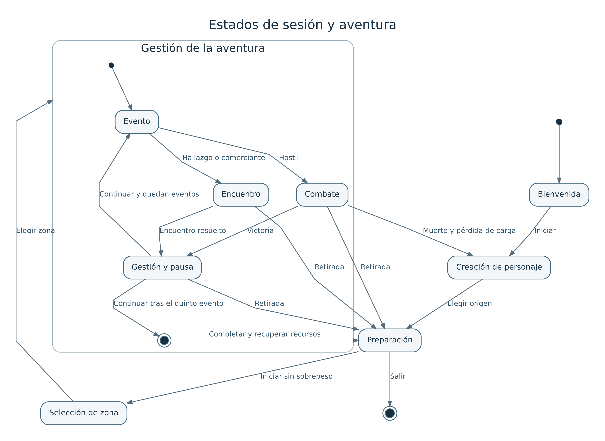

[Fuente editable](diagramas/01-estados.mmd) · [Versión SVG](diagramas/01-estados.svg)

*Figura 1. Estados de sesión y aventura del diseño completo. Gestión comprende recogida de botín cuando corresponde y pausa antes de continuar. La retirada y el regreso exitoso tienen resultados distintos.*

### 2.2 Zonas y generación de eventos

| Zona | Organización principal | Niveles de enemigos |
|---|---|---|
| Watson | Maelstrom | 1–5 |
| Japantown | Tyger Claws | 6–12 |
| Dogtown | Barghest | 13–20 |

Todas las zonas están disponibles desde el inicio. Sus rangos son fijos y no se ajustan al personaje; la indicación de dificultad es una recomendación. Se permite repetir zonas fáciles. Las futuras organizaciones y Santo Domingo no forman parte de los pools del diseño completo.

Cada aventura contiene exactamente **cinco eventos** de la zona elegida. Las familias son combate, hallazgo y comerciante; predominan los combates. Al crear la aventura se realiza un sorteo independiente con probabilidad **1/3** de incluir un comerciante. Si corresponde, ocupa uno de los cinco lugares y aparece como máximo una vez. Este sorteo no garantiza una aparición cada tres aventuras ni se repite con probabilidad 1/3 en cada evento.

Los otros lugares se seleccionan del pool de combates y hallazgos de la zona. Sus pesos y recompensas son datos de balance. No hay desplazamiento por coordenadas ni cambio de distrito dentro de la aventura.

### 2.3 Pausas, recompensas y preparación

Después de vencer, se muestra el botín y el jugador elige qué recoger y en qué cantidad. Puede aceptar una carga que provoque sobrepeso. Lo que deje atrás se pierde al continuar.

Cuando quedan eventos, la pausa posterior al combate permanece hasta que el jugador decide avanzar. Informa brevemente qué encontrará en el siguiente evento, sin revelar cantidades exactas de daño ni todas sus recompensas. El evento previsto pertenece a la misma zona. La implementación conserva esa selección para que consultar el avance no vuelva a sortearla.

Fuera del combate, dentro de la aventura, se permite cambiar armas equipadas, accesorios y quickhacks, asignar puntos, consultar o descartar objetos y utilizar curación. Las tiendas y hallazgos ofrecen un estado sin combate equivalente para estas operaciones. Instalar o retirar implantes exige al ripperdoc en preparación; stash y crafting también se utilizan desde preparación.

La experiencia de los encuentros actualiza la progresión; los puntos disponibles se pueden distribuir en los estados permitidos. El tiempo real empleado en menús no regenera recursos ni resuelve eventos.

## 3. Personaje y progresión

**Alcance:** en el MVP los tres orígenes se diferencian por el arma inicial y reciben el kit reducido de la sección 1.3. La progresión, los puntos y las habilidades de esta sección se implementarán después.

### 3.1 Orígenes y equipo inicial

El jugador es un personaje independiente. Su origen representa un antecedente y no una afiliación actual. No hay subelecciones de corporación, pandilla o tribu en el diseño completo.

| Origen | Arma de tier 1 | Habilidad gratuita |
|---|---|---|
| Corpo | Pistola | Una habilidad del primer nivel del árbol de Inteligencia |
| Street | Subfusil | Una habilidad del primer nivel del árbol de Cool |
| Nomad | Escopeta de corredera | Una habilidad del primer nivel del árbol de Fuerza |

Los tres reciben un cyberdeck básico, Cortocircuito, dos consumibles de curación y munición suficiente para dos cargadores de su arma: uno cargado y otro en reserva. Comienzan sin dinero y en nivel 1.

La habilidad gratuita pertenece al catálogo general de quince habilidades. Otros orígenes pueden adquirirla cumpliendo sus requisitos; no existen árboles exclusivos. Los datos iniciales deben ser coherentes con la capacidad de cyberware y los requisitos de la habilidad otorgada.

### 3.2 Atributos y puntos

Los atributos son Inteligencia, Fuerza, Agilidad, Habilidad técnica y Cool. Cada uno comienza en **1**, tiene un máximo de **10** y dispone de su propio árbol.

| Momento | Puntos de atributo | Puntos de habilidad |
|---|---:|---:|
| Creación en nivel 1 | 5 para repartir | 1, además de la habilidad del origen |
| Cada subida del nivel 2 al 20 | 1 | 1 |
| Nivel 20 alcanzado | No hay más subidas | No hay más subidas |

El nivel máximo es **20**. Al alcanzarlo se pueden seguir realizando aventuras. La experiencia determina las subidas mediante una tabla de umbrales; no se gasta directamente para comprar atributos o habilidades.

Los puntos asignados son permanentes durante la vida del personaje. Los no utilizados pueden conservarse para asignarlos posteriormente en preparación o fuera del combate.

Al nivel 20 se habrán recibido 24 puntos de atributo para repartir, además de los cinco valores base: la suma total posible es 29. Ningún atributo puede superar 10.

### 3.3 Árboles de habilidades

Se incluyen **quince habilidades, tres por atributo**. Cada habilidad cuesta un punto y se adquiere una sola vez. Se organizan por niveles de profundidad del árbol, distintos del nivel del personaje. Cada árbol debe contener al menos una dependencia entre una habilidad inferior y otra superior.

Para desbloquear una habilidad se comprueban sus requisitos de atributo y las habilidades previas que tenga asociadas. Las dependencias no pueden formar ciclos. La mayoría de los efectos son bonificaciones porcentuales a estadísticas; el catálogo evita multiplicar innecesariamente las acciones disponibles.

El diseño completo no incluye rangos adicionales de una misma habilidad ni puntos obtenidos en hallazgos. Al llegar al nivel 20 habrá 20 puntos de habilidad concedidos por creación y subidas. Como una de las quince habilidades viene desbloqueada, adquirir las otras catorce dejaría seis puntos sin gastar; los requisitos pueden dejar aún más puntos disponibles. Se acepta que esos puntos no tengan efecto.

La ampliación futura incorporará más habilidades y obligará a elegir cuáles adquirir con los puntos disponibles; no permitirá tener todas simultáneamente. No modifica la concesión de puntos del diseño completo.

## 4. Combate y acciones

**Alcance:** el MVP conserva un enemigo, intención aproximada, alternancia de una acción, selección gratuita de arma, ataques, curación, recarga y espera. Las interacciones con recursos avanzados, estados, implantes y hackeos se reservan para el diseño completo.

### 4.1 Participantes e intención

Cada combate enfrenta al jugador con un solo enemigo. El jugador actúa primero. La base distingue personas y bots, y mantiene el rol de combate y la organización como datos del enemigo. Los roles de referencia son tirador, francotirador, combatiente cuerpo a cuerpo y netrunner; sus equipos deben ser coherentes con el rol y la zona.

Antes de elegir, se muestra una intención aproximada: disparar, golpear, hackear o curarse. No se anticipan el daño exacto, el hackeo concreto ni la magnitud de una curación.

La regla general es **una acción efectiva por turno**. Navegar por las categorías del menú o seleccionar un arma ya equipada no consume acciones. Ejecutar el ataque sí las consume.

### 4.2 Acciones disponibles

| Acción | Comportamiento |
|---|---|
| Atacar con arma | Consume una acción, stamina y la munición que corresponda. Puede acertar o fallar. |
| Ataque básico | Consume una acción y stamina. Lo reemplaza el implante de brazos cuando puede utilizarse. |
| Ejecutar quickhack | Consume una acción y RAM del cyberdeck; resuelve su efecto en esa acción. |
| Usar curación | Consume una acción durante el combate. También puede utilizarse fuera de él. |
| Recargar | Consume una acción en combate y toma del inventario la munición necesaria. |
| Activar cyberware | Aplica el coste y efecto de su definición; Sandevistan tiene la regla particular de la sección 8. |
| Esperar | Consume la acción y permite continuar el ciclo de turnos. |
| Retirarse | Finaliza inmediatamente el combate y la aventura aplicando las pérdidas de la sección 5.3. |

Una acción ejecutada que falla por precisión conserva su coste. Un quickhack bloqueado por Self-ICE consume acción y RAM. En cambio, cuando faltan recursos o la selección es inválida antes de ejecutar, se informa la causa y no se realiza el gasto.

Los ataques físicos usan probabilidad de acierto, modificable por atributos, equipo, habilidades y estados. Los quickhacks no usan ese cálculo de precisión; se resuelven según sus defensas específicas.

### 4.3 Orden de resolución

Al comienzo del turno de cada participante se procesa el daño persistente, se comprueba la muerte y, si sigue vivo, se aplica la regeneración permitida. Luego se resuelven las acciones disponibles. Se comprueba la muerte también después de cada acción con efecto sobre salud.

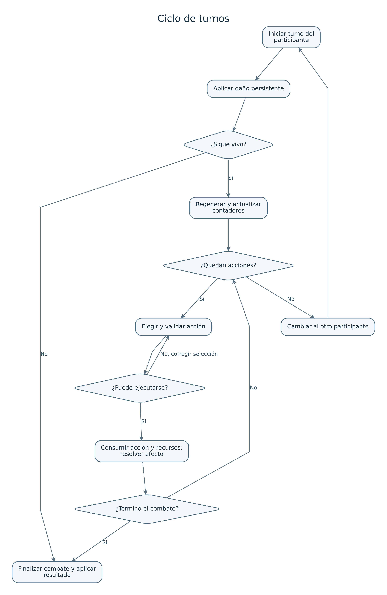

[Fuente editable](diagramas/02-turnos.mmd) · [Versión SVG](diagramas/02-turnos.svg)

*Figura 2. Ciclo de turnos del diseño completo. Cada acción ejecutada consume su acción; los efectos específicos pueden conceder otra. Sin acciones disponibles se cambia de participante y comienza su turno.*

Perder un turno significa perder sus acciones, no omitir daño persistente, regeneración ni actualización de enfriamientos. Un enemigo cuya intención de disparar quedó bloqueada intenta ejecutarla y consume una acción sin disparar. Si esa era su única acción, termina el turno; si dispone de otra, puede usarla para un ataque alternativo.

## 5. Recursos, efectos y resultados

**Alcance:** el MVP utiliza salud, munición y curaciones; conserva salud entre eventos, recuperación total al completar la aventura y pérdida por muerte. Escudo, stamina, RAM, regeneración por turnos, efectos y retirada se posponen.

### 5.1 Recursos y escudo

Salud, escudo y stamina pertenecen a la entidad. La RAM pertenece al cyberdeck instalado. Sus máximos, costes y tasas se obtienen del balance, los atributos, las habilidades y el equipo activo.

El escudo **reduce parcialmente** el daño y se desgasta por la cantidad que evitó. Con menos escudo disponible, su capacidad de reducción disminuye. No equivale a una segunda barra de salud que absorba completamente los ataques.

Para un impacto de daño `D`, si la configuración determina que el escudo evita `A`, la salud pierde `D − A` y el escudo pierde `A`. La cantidad evitada no puede superar el escudo restante ni convertir la protección ordinaria en una mitigación completa. La curva que determina `A` y su redondeo son parámetros de balance, no una fórmula elegida por atribución al juego original.

### 5.2 Recuperación y efectos temporales

- Cada turno permite regeneración según sus tasas y estados. Un efecto inhibidor puede impedirla.
- Al terminar el combate desaparecen los efectos temporales positivos y negativos, y se reinician los enfriamientos.
- Los valores actuales de salud, escudo, stamina y RAM se conservan.
- Entre eventos completados se aplica una única recuperación equivalente a **tres turnos**. Permanecer en un menú no vuelve a aplicarla.
- El regreso exitoso tras el quinto evento recupera por completo los recursos.
- La retirada no equivale a completar un evento ni otorga la recuperación completa del regreso exitoso.

Si un implante desactivado aportaba un máximo de recurso, el máximo se recalcula y el valor actual se limita a él. Al volver a funcionar, recuperar el máximo no cura automáticamente. Ejemplo: salud **100/120 → 80/80 → 80/120**. El mismo criterio se aplica a escudo, stamina y RAM.

### 5.3 Victoria, muerte, retirada y cierre

| Resultado | Personaje y recursos | Objetos |
|---|---|---|
| Victoria en combate intermedio | Sigue la aventura; se eliminan estados temporales y se aplica la recuperación entre eventos. | Puede recoger selectivamente el botín. |
| Aventura completada | Vuelve a preparación con recuperación completa. | Conserva lo transportado y lo obtenido. |
| Muerte | Se elimina el personaje; debe crear otro. | Se pierden sus pertenencias transportadas; el stash permanece. |
| Retirada, en combate o entre eventos | Vuelve a preparación con nivel, atributos, habilidades y recursos actuales; sin recuperación completa. | Pierde todas las armas transportadas, sus accesorios instalados, la munición cargada y el dinero. |
| Cierre del juego | El personaje no se guarda. | Solo permanece lo depositado mediante transferencias al stash. |

En una retirada se conservan cyberware, quickhacks, consumibles distintos del dinero, componentes, munición de reserva y accesorios sueltos. Las armas perdidas incluyen las equipadas y las que estaban sueltas en el inventario. El stash no resulta afectado.

## 6. Inventario y stash

**Alcance:** el MVP incluye inventario, equipamiento de armas y stash persistente con cantidades. Peso/sobrepeso y tratamiento de implantes, accesorios y quickhacks se incorporarán en la fase completa.

### 6.1 Peso y equipamiento

Cada objeto transportado aporta su peso, multiplicado por la cantidad si forma una pila. Los accesorios y la munición cargada se contabilizan una sola vez junto con el resto de la carga. Los eurodólares no pesan. Los implantes pesan mientras están transportados como objetos sueltos, pero **no aportan peso cuando están instalados**.

La capacidad aumenta con Fuerza, determinadas habilidades y cyberware. Sobrepasarla aumenta costes de recursos, reduce la probabilidad de críticos y reduce la regeneración. No aumenta el número de balas consumidas por disparo.

El sobrepeso permite conservar botín ya recogido, pero impide iniciar otra aventura desde preparación. La interfaz explica cómo reducir la carga, por ejemplo guardando objetos en el stash. Desactivar un implante que aumentaba capacidad puede provocar sobrepeso temporal.

Una Person puede tener hasta tres armas equipadas y un Bot hasta una. Las armas equipadas siguen perteneciendo al inventario; equipar no crea copias.

### 6.2 Stash compartido

El stash es único, ilimitado y compartido por los personajes de esa instalación. Admite todos los tipos de objeto salvo dinero. Las transferencias de consumibles y otras pilas permiten elegir cantidad.

Cada depósito o retirada se guarda inmediatamente en SQLite. No existe un guardado del personaje asociado a esa operación.

Al depositar un arma se desequipa, se separan los accesorios y se descarga la munición. El arma, los accesorios y las balas se guardan por separado. Al depositar un cyberdeck, sus quickhacks se separan y se guardan individualmente. La interfaz avisa de esta separación antes de completar la operación.

Un implante instalado no puede ir directamente al stash: primero se retira en el ripperdoc, luego se deposita desde el inventario. Retirar un cyberdeck del stash no reconstruye su configuración anterior.

### 6.3 Integridad de transferencias

La operación valida pertenencia, cantidad y elegibilidad; prepara todos los objetos resultantes; ejecuta la modificación del stash en una transacción; y actualiza las referencias de inventario y equipo de manera coordinada. Depositar un arma configurada constituye una sola transferencia lógica, aunque modifique varias filas.

Ante un error previo a la confirmación, la operación no informa éxito y conserva el estado original. Una retirada rechazada no elimina objetos del stash. Un depósito rechazado no quita objetos del inventario. La aplicación no sustituye silenciosamente una base inválida por otra vacía.

La transacción garantiza el cambio completo o nulo **en la base de datos**. El inventario en memoria no forma parte de esa transacción; su coordinación corresponde al servicio de transferencias. Si el proceso se interrumpe después de retirar un objeto de forma confirmada, ese objeto ya pertenece al personaje no persistente y puede perderse al cerrar. El estado de la sesión no se recupera porque el personaje y su inventario no son persistentes.

## 7. Armas, munición y accesorios

**Alcance:** el MVP utiliza pistola, subfusil y escopeta de corredera, munición y recarga. El resto de variantes, accesorios, etiquetas tecnológicas y mejoras de tier no son obligatorios para el 02/12.

### 7.1 Catálogo y calidad

| Categoría interna | Variantes iniciales |
|---|---|
| Handgun | Pistola, revólver, subfusil |
| Heavy | Rifle de asalto, rifle de precisión |
| Shotgun | Escopeta de doble cañón, escopeta de corredera |
| Melee | Espada, bate o arma contundente equivalente |

Son nueve variantes de contenido; no requieren nueve clases C# distintas. Power, Tech y Smart son etiquetas descriptivas en el diseño completo.

Las armas y el cyberware tienen **cinco tiers, del 1 al 5**. Cada mejora avanza un tier y aplica las estadísticas y costes predefinidos. Dos objetos del mismo modelo y tier tienen las mismas estadísticas base: no hay tiradas aleatorias individuales.

### 7.2 Munición y recarga

Cada arma de fuego mantiene su cantidad cargada, su capacidad de cargador y el tipo de munición compatible. Al agotarse, no puede disparar hasta recargar; si tampoco hay reserva compatible, debe utilizarse otra acción.

Recargar durante el combate consume una acción completa. Puede hacerse con el cargador parcialmente lleno y toma solamente la cantidad necesaria, limitada por la reserva disponible. Las balas ya cargadas no se desperdician.

El cargador accesorio y la munición cargada son conceptos distintos. Como criterio técnico de integridad, al reducir la capacidad mediante un cambio de accesorio se conserva cualquier excedente como munición de reserva, sin duplicarlo ni eliminarlo accidentalmente.

### 7.3 Accesorios

Las armas de fuego admiten **una mira y un cargador modificable**, sujetos a la compatibilidad indicada por su variante. Las armas cuerpo a cuerpo no tienen accesorios en el diseño completo. Cambiar accesorios está permitido desde inventario fuera del combate, incluso durante una aventura.

Las bonificaciones concretas de miras y cargadores pertenecen a sus datos de catálogo. Los nuevos tipos de accesorios orientados a daño o críticos quedan para una ampliación futura.

## 8. Cyberware y quickhacks

**Alcance:** toda esta sección corresponde al desarrollo posterior al MVP. Sus reglas forman parte del diseño funcional del sistema.

### 8.1 Zonas corporales y capacidad

Existe un solo implante instalado por zona y un presupuesto total de capacidad. Al instalar o mejorar, la suma de costes instalados no puede superar la capacidad disponible. Una desactivación temporal conserva las instalaciones y recalcula sus efectos; no extrae implantes automáticamente. La capacidad no representa un sistema de salud mental ni produce efectos psicológicos.

| Zona corporal | Catálogo base |
|---|---|
| Sistema operativo | Militech Paraline, Tetratronic Rippler y Dynalar Sandevistan |
| Corteza frontal | Ex-Disk y Self-ICE |
| Ojos | Kiroshi básico y Kiroshi Cockatrice |
| Sistema circulatorio | Blood Pump y Heal-On-Kill |
| Sistema nervioso | NeoFiber y Reflex Tuner |
| Sistema tegumentario | Subdermal Armor y Shock-n-Awe |
| Esqueleto | Titanium Bones y Dense Marrow |
| Manos | Microgenerator e Immovable Force |
| Brazos | Gorilla Arms, Mantis Blades, Monowire y Projectile Launch System |
| Piernas | Jenkins’ Tendons y Leeroy Ligament System |

La tabla establece el catálogo base de implantes. El objetivo de contenido del diseño completo es ofrecer alrededor de cuatro alternativas en la mayoría de las zonas corporales, con varios cyberdecks y un Sandevistan en el sistema operativo. La carga de contenido define las alternativas adicionales y sus estadísticas. Todos los efectos se adaptan al combate por turnos y a las acciones disponibles.

El ripperdoc instala y extrae implantes y cobra una tarifa pequeña por cada operación, además del precio de los implantes vendidos. El cyberware se compra exclusivamente allí y puede encontrarse como botín en eventos. Los jefes como fuente de botín quedan fuera del diseño completo.

Los implantes pueden mejorarse estando instalados, desde preparación. Si el nuevo tier excede la capacidad, la mejora se bloquea **antes de consumir componentes**.

### 8.2 Brazos y ataque básico

Los implantes de brazos reemplazan el golpe con la mano desnuda y no ocupan un espacio de arma equipada. Si están desactivados o su ataque no puede utilizarse, se ofrece nuevamente el golpe físico básico, sujeto a su coste de stamina. Si tampoco puede pagarlo, permanece la opción de esperar.

### 8.3 Cyberdeck y quickhacks

Cada cyberdeck permite equipar hasta **cuatro quickhacks**. Se pueden cambiar desde inventario fuera del combate. La RAM limita su ejecución y se regenera según la configuración del cyberdeck y los modificadores activos.

Los quickhacks se compran en tiendas comunes y en los comerciantes de aventura; también se pueden fabricar. Ejecutar uno consume su acción y RAM y resuelve sus efectos en esa acción, sin una fase adicional de carga. Los efectos persistentes continúan después según su duración.

| Quickhack del catálogo del jugador | Función |
|---|---|
| Cortocircuito | Daño eléctrico directo, con diferenciación contra bots. |
| Sobrecalentamiento | Daño persistente. |
| Fallo de arma | Bloqueo temporal del uso del arma afectada. |
| Fallo de cyberware | Desactiva temporalmente todos los efectos de los implantes, incluidos los pasivos. |
| Quemado sináptico | Daño relacionado con la RAM gastada. |
| Suicidio | Ejecución de coste elevado de RAM, capaz de eliminar a la mayoría de los enemigos. |

Los netrunners enemigos utilizan hackeos básicos de daño y control, entre ellos Fallo de arma y Reboot Optics. El hackeo de ejecución instantánea es exclusivo del jugador. Reboot Optics reduce la probabilidad de acierto físico a **menos del 10 %**, sin afectar el cálculo de ejecución de quickhacks.

### 8.4 Sandevistan, Self-ICE y desactivación

**Sandevistan.** Activarlo consume una acción y concede una acción adicional en ese mismo turno. Partiendo de una acción, después de activarlo queda una acción para ejecutar otra operación. El oponente pierde las acciones de su siguiente turno. El enfriamiento inicial es de **cuatro turnos propios**, incluidos los turnos sin acciones, y se reinicia al finalizar el combate.

**Self-ICE.** Bloquea el primer quickhack recibido en cada combate. Los siguientes hackeos de daño reciben una reducción según el balance. Esta reducción de daño no equivale a inmunidad permanente contra efectos de control o ejecución instantánea.

**Fallo de cyberware.** Desactiva efectos activos y bonos pasivos, incluido Self-ICE. Para hacerlo debe superar primero las defensas de aplicación: si es el primer hackeo contra un Self-ICE disponible, queda bloqueado y consume esa protección. Desactivar implantes no los desinstala.

El sistema recalcula los valores derivados y limita recursos actuales a los nuevos máximos. Los enfriamientos y el bloqueo inicial de Self-ICE se registran como estado de combate, separado de los datos persistentes del objeto.

## 9. Fabricación y economía

**Alcance:** toda esta sección corresponde al desarrollo posterior al MVP. Tiendas, ripperdoc y operaciones de crafting no son criterios de aceptación de la primera entrega.

### 9.1 Matriz de operaciones

Fabricar, mejorar y desarmar se realizan durante la preparación. Todas las recetas del diseño completo están desbloqueadas desde el inicio.

| Familia | Fabricar | Mejorar | Desarmar |
|---|---|---|---|
| Armas | Sí | Sí | Sí |
| Cyberware | No | Sí | No |
| Accesorios | Sí | No | Sí |
| Quickhacks | Sí | No | No |
| Munición | Sí | No | No |
| Objetos de curación | Sí | No | Sí |

Fabricar utiliza una receta definida y sus componentes. Mejorar armas o cyberware consume componentes, avanza un tier y no cobra dinero ni permite elegir ramas de mejora. Desarmar destruye el objeto seleccionado y entrega los componentes definidos. No se agrega una familia exclusiva de componentes para quickhacks.

El servicio valida todos los requisitos antes de consumir materiales. En operaciones destructivas sobre equipo debe resolver primero sus referencias y accesorios; no se admiten objetos duplicados ni referencias a un objeto ya destruido.

### 9.2 Comercio y stock

| Comerciante | Disponibilidad | Oferta y existencias |
|---|---|---|
| Tienda de preparación | Desde el menú | Oferta estable, cantidades limitadas que se reponen al regresar de una aventura. |
| Ripperdoc | Desde el menú | Cyberware y operaciones de instalación/extracción; existencias limitadas que se reponen. |
| Comerciante de aventura | Evento sorteado, máximo uno | Selección de productos especiales y cantidades limitadas; puede tener precios especiales. |

Las tiendas compran los objetos de las familias que comercializan. El cyberware se compra y vende en el ripperdoc, nunca en la tienda común ni en el comerciante ordinario de aventura. Los quickhacks pertenecen al comercio común.

El dinero se usa para compras y servicios del ripperdoc. No se guarda en el stash y se pierde al retirarse. Los precios, tarifas, cantidades de stock, costes de recetas y rendimientos de desarme se configuran y se revisan conjuntamente durante el balance.

## 10. Arquitectura y diagramas de clases

**Alcance:** las figuras 3–8 muestran el modelo técnico objetivo. La sección 10.7 identifica las partes necesarias para el MVP y las que pueden quedar sin implementar. No se requiere construir clases de sistemas posteriores solo para reproducir el diagrama.

### 10.1 Organización y responsabilidades

Se utiliza C# con Spectre.Console y se separan presentación, coordinación del juego, dominio y acceso a datos. El dominio no imprime mensajes ni solicita entradas: devuelve resultados que la interfaz presenta en español.

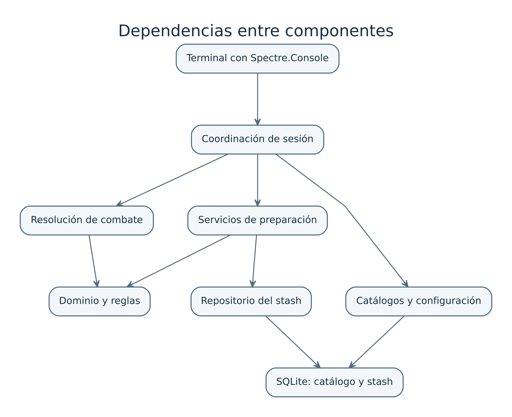

[Fuente editable](diagramas/03-arquitectura.mmd) · [Versión SVG](diagramas/03-arquitectura.svg)

*Figura 3. Dependencias entre componentes. Cada flecha indica qué componente utiliza al siguiente. Los resultados regresan por las llamadas; el dominio no depende de la interfaz.*

| Componente | Responsabilidad |
|---|---|
| GameSession / GameState | Mantener personaje actual, estado de pantalla, stash y aventura activa. |
| CombatController | Alternar turnos, mostrar la intención, administrar acciones y detectar el fin del combate. |
| ActionResolver | Validar la acción, consumir costes y aplicar resultados, sin imprimir ni leer consola. |
| DamageCalculator | Calcular acierto, críticos y distribución del daño entre salud y escudo según el balance. |
| Inventory / Equipment | Mantener pertenencia, referencias de equipo, carga, compatibilidades y recursos cargados. |
| ProgressionService | Aplicar experiencia, límites, puntos y requisitos de habilidades. |
| CraftingService / ShopService / RipperdocService | Ejecutar las operaciones permitidas y sus costes. |
| StashService | Coordinar transferencias, separación de accesorios, descarga y estado en memoria. |
| IStashRepository / SqliteStashRepository | Definir el contrato y ejecutar lectura y escritura de cantidades persistentes mediante transacciones. |
| ItemCatalog / ItemFactory | Leer definiciones y construir los objetos del dominio a partir de ellas. |
| Configuración de contenido | Definir zonas, pools, habilidades, recetas y parámetros de balance como datos del programa. |

La configuración del proyecto fija las versiones del SDK de .NET y de sus paquetes durante la preparación del entorno. Esas versiones se registran en las instrucciones de compilación. El plan de trabajo incluye el empaquetado y la validación en Windows 11.

### 10.2 Entidades, atributos y habilidades

Los diagramas de clases son vistas complementarias del mismo modelo. Una clase repetida con solo su nombre conserva los atributos de su vista principal. El triángulo vacío apunta a la clase base o al contrato; el rombo negro se ubica en el propietario de una composición. Las flechas de asociación indican una referencia; las dependencias discontinuas indican uso. Las multiplicidades restringen cuántas instancias se relacionan [F05, F06].

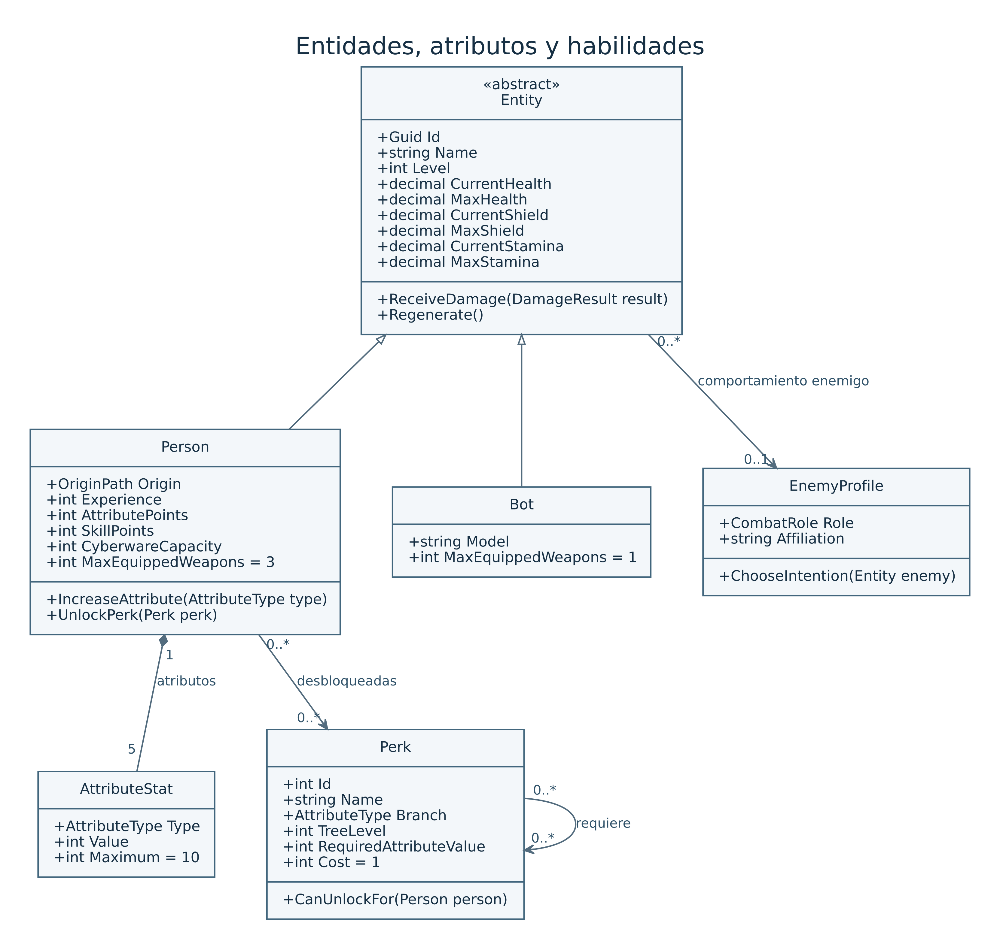

[Fuente editable](diagramas/04-clases-entidades.mmd) · [Versión SVG](diagramas/04-clases-entidades.svg)

*Figura 4. Diseño completo: Entidades y progresión. Nivel máximo del jugador: 20; cada árbol contiene tres habilidades.*

Los campos de origen y progresión se utilizan para el personaje jugador. Los enemigos Person se configuran desde sus perfiles; no reciben una afiliación actual del jugador. El rol no exige una subclase por cada combinación de arma y organización. Un perfil puede configurar varios enemigos; el personaje del jugador no necesita EnemyProfile.

La lista de habilidades desbloqueadas impide compras duplicadas. El requisito de atributo y las dependencias se comprueban antes de descontar el punto. Los valores derivados se recalculan desde sus fuentes y no se almacenan como copias independientes de esas fuentes.

### 10.3 Objetos, inventario y equipamiento

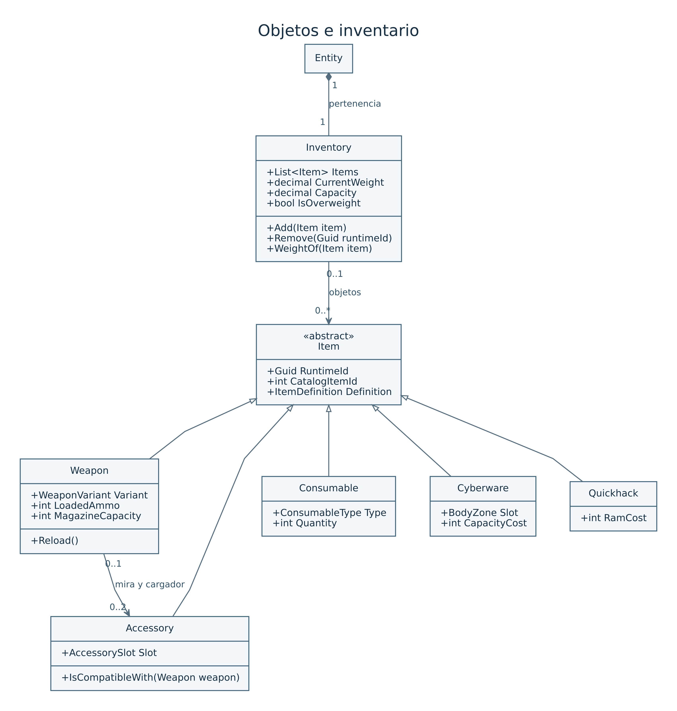

[Fuente editable](diagramas/05-clases-objetos.mmd) · [Versión SVG](diagramas/05-clases-objetos.svg)

*Figura 5. Diseño completo: Instancias de objetos en memoria. Un identificador de catálogo no sustituye al identificador de instancia.*

Cada arma concreta mantiene su propio cargador aunque comparta definición con otra. Los consumibles pueden formar pilas. Cada instancia pertenece como máximo a un inventario; el botín pendiente de recoger todavía no pertenece a ninguno. Equipamiento y accesorios son referencias a esas mismas instancias. Una instancia no puede estar en dos inventarios ni equipada por dos entidades a la vez.

Las relaciones de equipo no implican por sí mismas destrucción del objeto: la muerte, retirada, fabricación y transferencias aplican reglas explícitas. Se evita usar indicadores globales independientes como `Item.IsEquipped` que puedan contradecir las referencias del equipamiento.

### 10.4 Equipamiento, cyberware y efectos

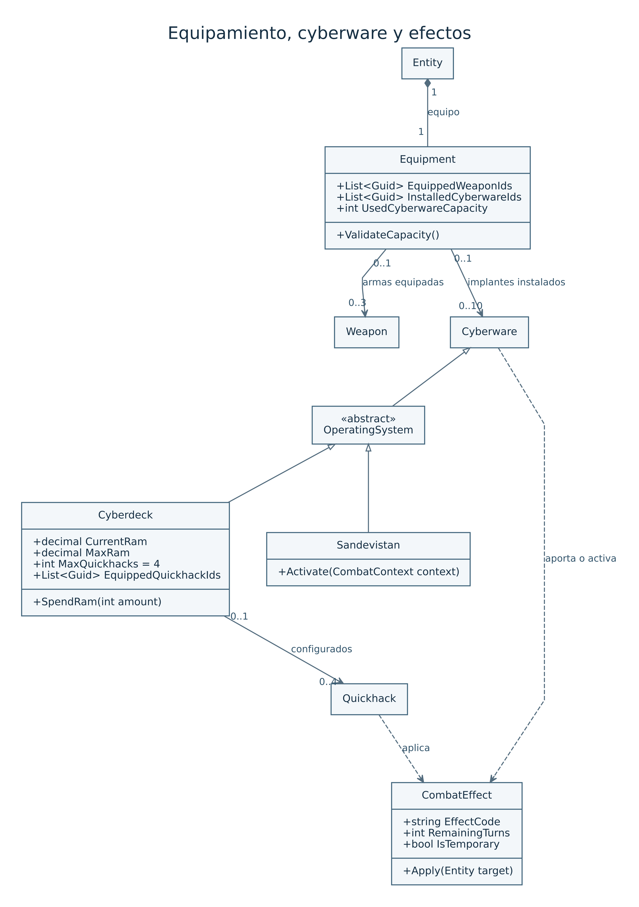

[Fuente editable](diagramas/06-clases-equipo.mmd) · [Versión SVG](diagramas/06-clases-equipo.svg)

*Figura 6. Diseño completo: Sistemas operativos y efectos. Las referencias de equipo deben pertenecer al inventario del personaje.*

Equipment pertenece a una entidad y referencia sus armas e implantes. Person admite hasta tres armas y Bot hasta una; el límite general de la asociación se restringe según el tipo. Los diez espacios corporales admiten como máximo un implante por zona. Cada arma tiene como máximo una mira y un cargador compatibles. Un quickhack puede estar configurado en un solo cyberdeck a la vez.

El presupuesto se verifica al instalar y al mejorar un implante instalado. La desactivación temporal conserva sus referencias, pero excluye sus efectos del cálculo. Los indicadores de bloqueo de Self-ICE y los enfriamientos pertenecen al contexto del combate, de modo que no se persisten ni se reinician por cambiar una referencia visual.

### 10.5 Sesión, aventuras y persistencia

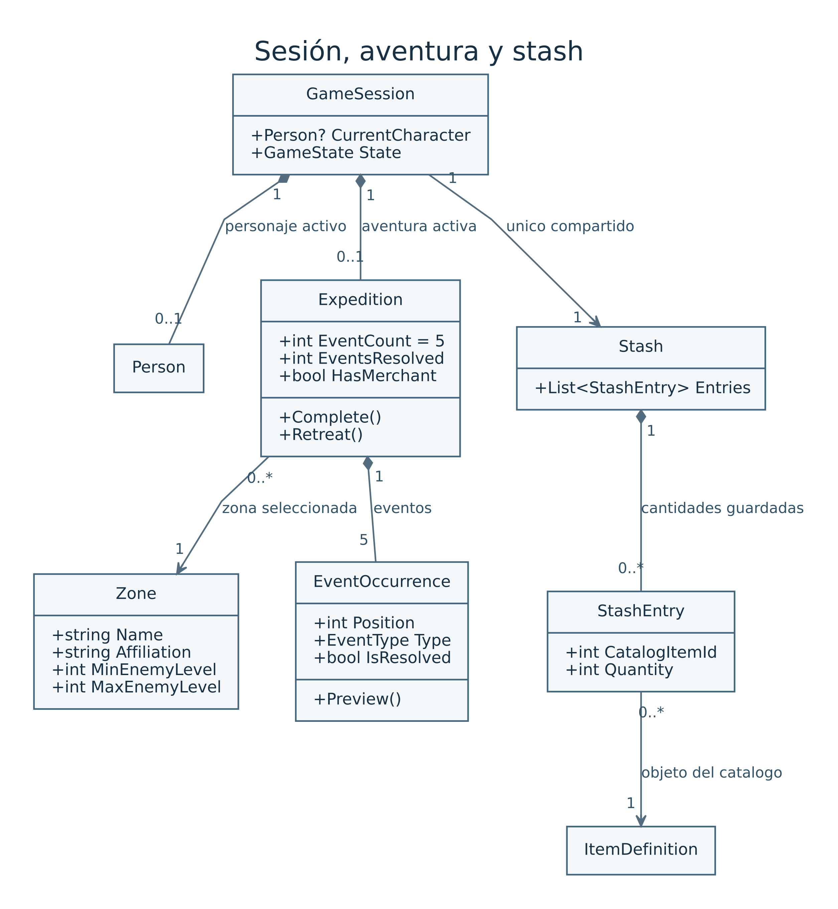

[Fuente editable](diagramas/07-clases-sesion.mmd) · [Versión SVG](diagramas/07-clases-sesion.svg)

*Figura 7. Diseño completo: Estado de sesión y aventura. Los sucesos seleccionados son ocurrencias; no alteran la definición del pool.*

La sesión contiene cero o un personaje activo y cero o una aventura. El stash existe durante toda la sesión; sus cantidades se recuperan de SQLite y se vinculan con definiciones del catálogo. Las composiciones indican pertenencia de objetos en memoria, no almacenamiento del personaje.

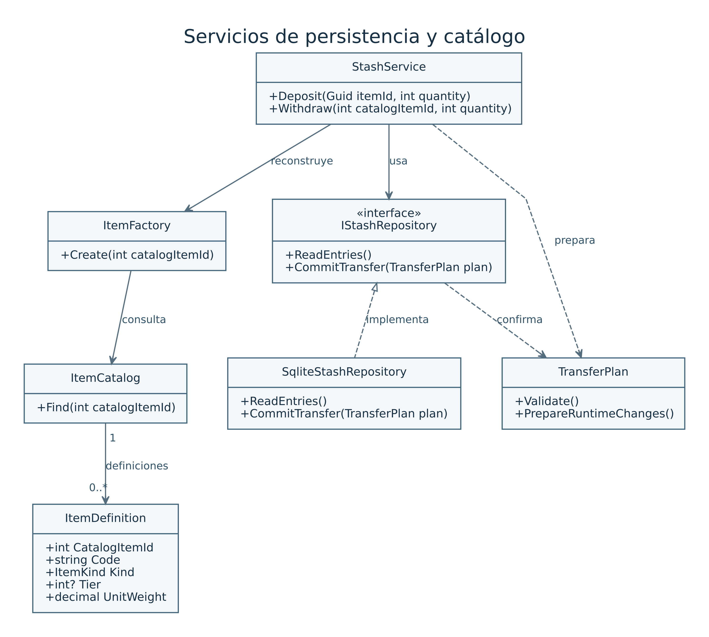

[Fuente editable](diagramas/08-clases-persistencia.mmd) · [Versión SVG](diagramas/08-clases-persistencia.svg)

*Figura 8. Diseño completo: Contrato de transferencia. Los nombres y firmas representan diseño técnico, no una API ya implementada.*

El stash agrupa objetos equivalentes por entrada de catálogo y cantidad. Como no conserva accesorios instalados, munición cargada, quickhacks configurados ni estadísticas aleatorias, no necesita guardar una fila por arma individual. Al recuperar varias armas se crean instancias independientes; al recuperar consumibles se reconstruye la cantidad correspondiente.

### 10.6 Contratos de operaciones

| Resultado o contrato | Información y garantías |
|---|---|
| ActionResult | Validez, motivo de rechazo, acción consumida, costes, acierto o fallo y efectos resueltos. |
| DamageResult | Daño de entrada, daño aplicado a salud, cantidad evitada y gastada del escudo, valores restantes y muerte. |
| TransferPlan | Débitos y créditos por catálogo, objetos separados y cambios de referencias preparados antes de confirmar. |
| CraftingResult | Objetos y materiales consumidos, resultado creado o mejorado y causa de un rechazo. |
| ShopResult | Oferta, cantidad, coste o ingreso, stock resultante y validación de fondos. |

La interfaz muestra errores comprensibles y conserva una operación válida como siguiente paso. No se consumen puntos, materiales o dinero ante un rechazo previo a la ejecución. Los errores de persistencia no se presentan como guardados exitosos.

### 10.7 Subconjunto de clases para el MVP

El MVP utiliza las clases de los diagramas con operaciones limitadas al alcance inicial. Los campos de estado —salud actual, cargador, inventario y personaje— viven en memoria.

| Parte del modelo | Alcance del MVP |
|---|---|
| GameSession, GameState, Expedition, Zone, EventOccurrence | Bienvenida/preparación/combate/hallazgo; Watson; cinco eventos; regreso o muerte. Sin comerciante ni retirada. |
| Entity, Person, EnemyProfile | Personaje y enemigo con salud, arma e intención. Origen del jugador; perfiles básicos Maelstrom. Sin puntos, habilidades ni cyberware. |
| Item, Weapon, Consumable, Inventory, Equipment | Instancias de armas con cargador propio y pilas de munición/curación; referencias de equipo sin duplicación. Sin peso ni accesorios. |
| CombatController, ActionResolver, DamageCalculator | Turnos, validación, ataques y acierto/fallo, curación y recarga; daño a salud. Sin escudo, estados ni acciones de cyberware. |
| ItemCatalog, ItemDefinition, ItemFactory | Definiciones reducidas desde SQLite, estadísticas deterministas e instanciación. |
| Stash, StashEntry, StashService, IStashRepository, SqliteStashRepository, TransferPlan | Cantidades persistentes; depósito/retirada; desequipar y descargar armas al depositar. |
| ProgressionService, Perk, AttributeStat | Posteriores al MVP. |
| Cyberware, Cyberdeck, Quickhack, Accessory y servicios de economía | Posteriores al MVP. |

No se agrega una tabla de personajes para suplir su estado en memoria. El jugador equipa como máximo tres armas. La jerarquía de enemigos Bot y sus futuros sistemas no son necesarios para este MVP.

## 11. Modelo relacional

**Alcance:** las figuras 9–11 conservan el modelo relacional completo. La sección 11.7 presenta el subconjunto de cinco tablas para el MVP; solo STASH_ENTRY guarda progreso del jugador.

### 11.1 Motor y frontera de persistencia

Se utiliza **SQLite** como base local embebida. Se adapta al uso de una aplicación individual y permite distribuir el juego sin un servidor de base de datos separado [F01]. El archivo de base de datos reside en el equipo del jugador y se administra desde la aplicación.

La base contiene dos clases de datos:

1. **Catálogo de objetos:** definiciones, estadísticas y efectos usados para construir instancias.
2. **Stash:** cantidades depositadas por definición de objeto.

El catálogo es contenido del juego, no progreso del jugador. No se agregan tablas de usuarios, perfiles, personajes, inventario activo, combates, experiencia o dinero de sesión. Los pools, recetas, habilidades y balance se cargan como configuración del programa; esta decisión no agrega otro guardado del jugador.

### 11.2 Núcleo del modelo

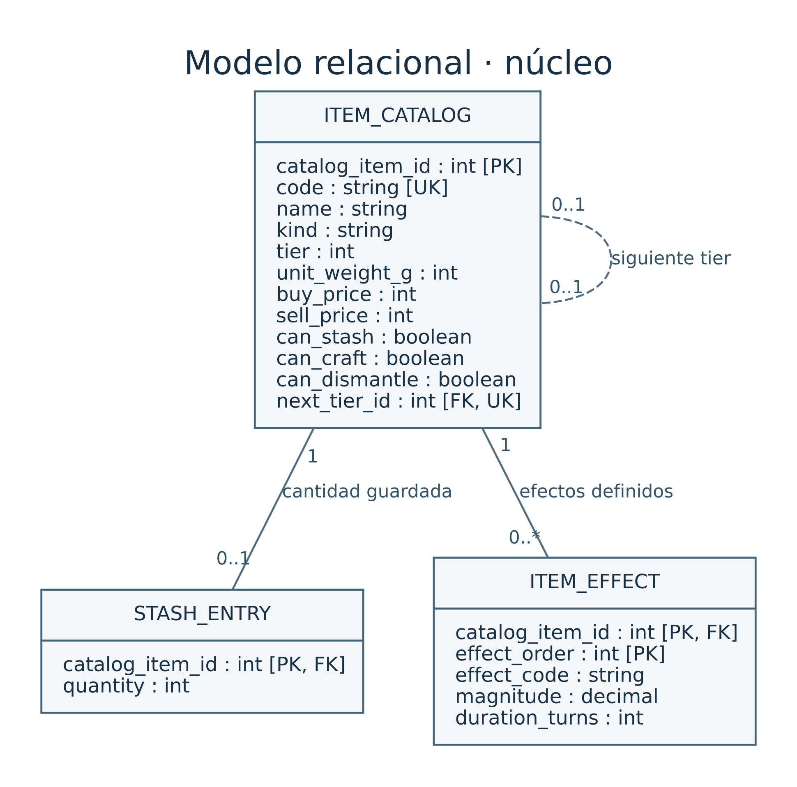

[Fuente editable](diagramas/09-bd-nucleo.mmd) · [Versión SVG](diagramas/09-bd-nucleo.svg)

*Figura 9. Diseño completo: Núcleo relacional. Solo STASH_ENTRY representa progreso persistente.*

Cada registro de ITEM_CATALOG identifica una versión concreta de un objeto. Un arma o implante de distinto tier tiene otra entrada, enlazada mediante `next_tier_id`; el tier 5 no tiene sucesor. Esto permite referenciar estadísticas deterministas sin repetirlas en el stash.

No se necesita una tabla STASH con múltiples propietarios: existe un único stash. Si se implementan perfiles en el futuro, se revisará este modelo en esa ampliación.

ITEM_EFFECT permite que un objeto aporte más de un modificador o efecto. `effect_code` identifica comportamiento conocido por el código C#; no contiene código ejecutable. El orden permite resolver efectos compuestos de manera definida.

### 11.3 Armas, accesorios y consumibles

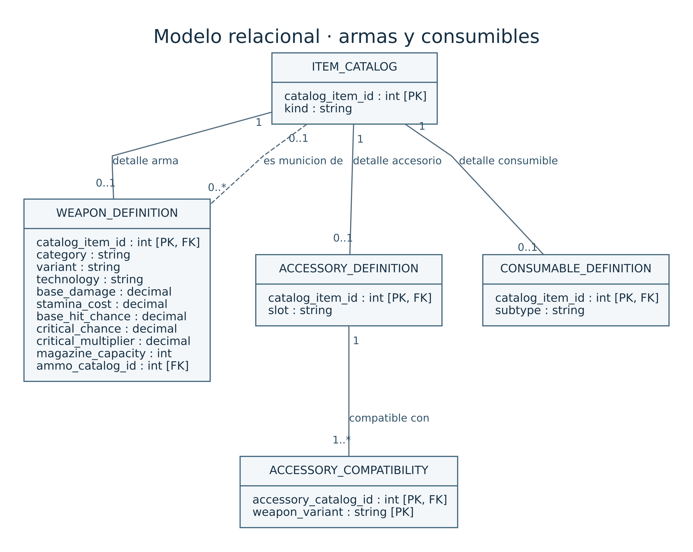

[Fuente editable](diagramas/10-bd-armas.mmd) · [Versión SVG](diagramas/10-bd-armas.svg)

*Figura 10. Diseño completo: Detalles específicos de armas, accesorios y consumibles.*

El campo `weapon_variant` usa los nueve valores del catálogo de la sección 7. La relación de munición debe apuntar a un consumible de munición. La cantidad cargada no está en WEAPON_DEFINITION: pertenece a cada arma en memoria y se vacía antes de guardar.

Los subtipos de consumible incluyen curación, munición, componentes y moneda. La moneda tiene peso cero y `can_stash = false`. La compatibilidad de accesorios se declara por variante y no por una categoría demasiado amplia.

### 11.4 Cyberware y quickhacks

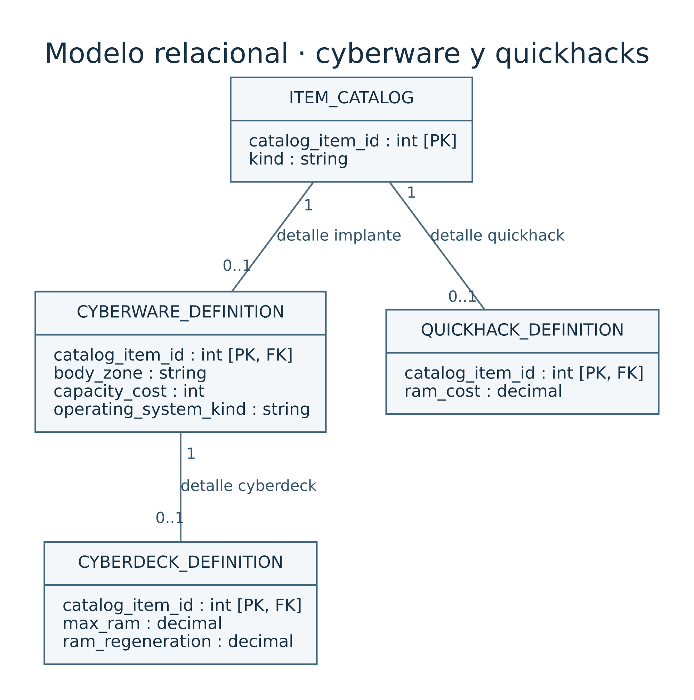

[Fuente editable](diagramas/11-bd-cyberware.mmd) · [Versión SVG](diagramas/11-bd-cyberware.svg)

*Figura 11. Diseño completo: Detalles de implantes y quickhacks. Los efectos se vinculan mediante ITEM_EFFECT.*

La RAM actual, la instalación corporal, los quickhacks equipados, los enfriamientos y los estados temporales no se guardan en estas tablas. Son propiedades de las instancias o del contexto de combate.

### 11.5 Diccionario de claves y restricciones

Las líneas continuas representan relaciones identificadoras: la clave del catálogo forma parte de la clave primaria del detalle. Las líneas discontinuas representan referencias no identificadoras, como la munición de un arma y el siguiente tier. PK es clave primaria, FK clave externa y UK valor único; las cardinalidades se leen en ambos extremos [F07].

En las imágenes, 1 significa exactamente uno; 0..1, cero o uno; 0..*, cero o más; y 1..*, uno o más. Las fuentes Mermaid expresan esas mismas multiplicidades mediante notación de pata de cuervo.

Los tipos de los diagramas son lógicos. Las restricciones de SQLite y las validaciones de carga concretan esos tipos y las reglas entre tablas.

| Tabla | Clave y referencias | Restricciones relevantes |
|---|---|---|
| ITEM_CATALOG | PK `catalog_item_id`; UK `code`; FK y UK opcional `next_tier_id` a la propia tabla. | Tipo válido; pesos y precios no negativos; tier 1–5 en armas/cyberware; sucesor del tier inmediato y cadena de mejora coherente. |
| STASH_ENTRY | PK y FK `catalog_item_id` a ITEM_CATALOG. | Cantidad entera positiva; una fila por definición; el dinero está prohibido. |
| ITEM_EFFECT | PK compuesta (`catalog_item_id`, `effect_order`); FK al catálogo. | Código de efecto conocido; orden no duplicado; duración válida cuando corresponda. |
| WEAPON_DEFINITION | PK/FK al catálogo; FK opcional de munición al catálogo. | Solo registros de tipo arma; variante válida; cargador y munición coherentes; melee sin munición. |
| ACCESSORY_DEFINITION | PK/FK al catálogo. | Solo accesorios; ranura mira o cargador. |
| ACCESSORY_COMPATIBILITY | PK compuesta de accesorio y variante; FK al detalle del accesorio. | Sin pares duplicados; al menos una variante compatible. |
| CONSUMABLE_DEFINITION | PK/FK al catálogo. | Subtipo reconocido; moneda no depositable. |
| CYBERWARE_DEFINITION | PK/FK al catálogo. | Zona corporal válida, coste de capacidad no negativo y tipo de sistema operativo coherente. |
| CYBERDECK_DEFINITION | PK/FK al detalle de cyberware. | Debe ser un sistema operativo cyberdeck; RAM máxima y regeneración válidas. |
| QUICKHACK_DEFINITION | PK/FK al catálogo. | Coste de RAM no negativo y efectos declarados. |

Las claves externas se habilitan por conexión con `PRAGMA foreign_keys = ON` [F02]. Se usan restricciones `CHECK` para cantidades y rangos locales. Las reglas que relacionan varias tablas —tipo correcto, dinero no depositable, sucesión de tiers y compatibilidades— se comprueban al cargar el catálogo y en los servicios correspondientes; una FK por sí sola no comprueba esas condiciones.

Las entradas de catálogo referenciadas por el stash no se borran de forma que deje objetos huérfanos. Las actualizaciones de contenido conservan sus identificadores o incluyen una migración explícita.

### 11.6 Escritura y recuperación

El esquema usa transacciones para que las filas afectadas por una transferencia se modifiquen juntas [F03]. Depositar cantidades incrementa o crea la fila; retirar las reduce y elimina la fila cuando llega a cero. Las consultas utilizan parámetros.

Al iniciar, el programa abre la base, valida su estructura, carga el catálogo y reconstruye las cantidades del stash. Una base nueva recibe el catálogo inicial. Una base existente inválida requiere un error explícito y una acción de recuperación; no se vacía automáticamente.

El diseño no promete un historial de transferencias, sincronización en línea ni recuperación del inventario activo. No se agregan esas capacidades a la entrega.

### 11.7 Modelo relacional del MVP

Se utilizan cinco tablas del modelo objetivo: catálogo general, cantidades del stash, detalle de armas, detalle de consumibles y efectos de objetos. ITEM_EFFECT permite almacenar la magnitud de curación como dato; utilizarla no obliga a implementar estados temporales ni un sistema genérico de scripting.

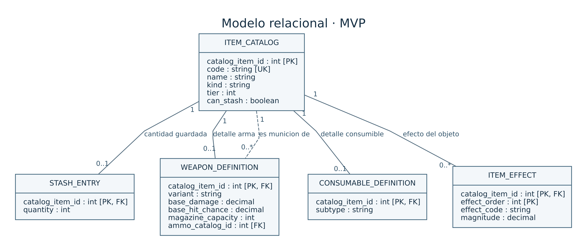

[Fuente editable](diagramas/12-bd-mvp.mmd) · [Versión SVG](diagramas/12-bd-mvp.svg)

*Figura 12. Modelo relacional reducido para la primera entrega. Las dos relaciones con WEAPON_DEFINITION representan su identidad y su referencia a la munición.*

Cada entrada es de tipo arma o consumible y debe tener exactamente el detalle que corresponda; se valida al cargar el catálogo. La FK de munición debe apuntar a un consumible de ese subtipo. Las armas del MVP son de fuego y requieren una referencia válida. La curación se configura mediante un código de efecto conocido y su magnitud, almacenados en el catálogo y calibrados con las pruebas de combate.

STASH_ENTRY conserva una fila por definición y cantidad. Un arma depositada se desequipa y descarga; la munición se guarda por separado, con aviso al jugador y una única transferencia lógica. Al retirar armas se crean instancias independientes con el cargador vacío. No se persisten cargadores ni estado del personaje.

Las columnas y tablas del modelo completo relativas a precios, peso, mejoras, accesorios, cyberware y quickhacks no son necesarias para operar el MVP. Pueden agregarse mediante migraciones posteriores que conserven los identificadores ya usados por el stash. No es necesario poblar el catálogo completo para entregar el catálogo reducido.

## 12. Requisitos y trazabilidad

Los requisitos funcionales se identifican como RF01–RF38 y se vinculan con sus casos de uso. Los requisitos no funcionales especifican las condiciones de calidad y operación.

**Interpretación de fases:** «MVP» obliga a su versión aplicable al catálogo reducido; «MVP parcial» exige únicamente lo indicado en la última columna y en 1.3; «Posterior al MVP» conserva el requisito objetivo sin exigirlo el 02/12. La columna de fase delimita el compromiso de implementación.

### 12.1 Requisitos funcionales

| ID | Requisito y aceptación prevista | Casos de uso | Fase de entrega |
|---|---|---|---|
| RF01 | Crear personaje Corpo, Street o Nomad con el arma, habilidad gratuita y equipo compartido de la sección 3. | CU05 | MVP parcial: origen y arma; kit reducido de 1.3. |
| RF02 | Conceder cinco puntos de atributo y uno de habilidad al iniciar; después uno de cada tipo por nivel hasta 20. | CU05, CU06 | Posterior al MVP. |
| RF03 | Consultar objetos, cantidades, peso, estadísticas y equipamiento. | CU03, CU07 | MVP parcial: objetos, cantidades, estadísticas y equipo; peso posterior. |
| RF04 | Limitar armas equipadas a tres para Person y una para Bot, sin duplicar objetos. | CU07 | MVP parcial: jugador; Bot no requerido. |
| RF05 | Limitar cyberware a uno por zona y al presupuesto total; validar también la mejora instalada. | CU04, CU10 | Posterior al MVP. |
| RF06 | Calcular peso con las excepciones de la sección 6, penalizar sobrepeso y bloquear nuevas aventuras. | CU01, CU07 | Posterior al MVP. |
| RF07 | Recuperar el stash después de cerrar y abrir; no recuperar personaje, dinero ni inventario de sesión. | CU03, CU14 | MVP. |
| RF08 | Ofrecer Watson 1–5, Japantown 6–12 y Dogtown 13–20 desde nivel 1, sin escalado automático. | CU01 | MVP parcial: solo Watson. |
| RF09 | Generar cinco eventos, mayormente combates, con sorteo de comerciante de 1/3 por aventura y máximo uno. | CU01 | MVP parcial: cinco combates/hallazgos; comercio posterior. |
| RF10 | Resolver combates contra un enemigo, sin aliados. | CU02 | MVP. |
| RF11 | Mostrar intención aproximada del enemigo, sin magnitudes exactas. | CU02 | MVP: acciones enemigas disponibles en esta versión. |
| RF12 | Alternar turnos con una acción general; procesar efectos incluso en turnos perdidos y respetar excepciones de cyberware. | CU02 | MVP parcial: alternancia básica; excepciones posteriores. |
| RF13 | Permitir selección gratuita entre armas equipadas; descontar la acción al ejecutar. | CU02 | MVP. |
| RF14 | Reducir parcialmente el daño con escudo y descontarle exactamente la cantidad evitada. | CU02 | Posterior al MVP. |
| RF15 | Mantener salud, escudo, stamina y RAM entre eventos; recuperar completamente al terminar la aventura con éxito. | CU01, CU02 | MVP parcial: salud y recuperación al regresar con éxito. |
| RF16 | Eliminar personaje y pertenencias transportadas al morir, conservando el stash. | CU02, CU05 | MVP. |
| RF17 | Permitir retirada garantizada en combate o entre eventos y aplicar todas las pérdidas de la sección 5.3. | CU13 | Posterior al MVP. |
| RF18 | Ofrecer ataque básico con stamina, sustitución por brazos y alternativa cuando el implante no puede usarse. | CU02 | MVP parcial: ataque sin arma; stamina/brazos posteriores. |
| RF19 | Fabricar los tipos permitidos con recetas disponibles desde el inicio; excluir cyberware. | CU11 | Posterior al MVP. |
| RF20 | Mejorar armas y cyberware del tier 1 al 5 con componentes, sin dinero ni ramas alternativas. | CU04 | Posterior al MVP. |
| RF21 | Desarmar únicamente armas, accesorios y curación, destruyendo el objeto y entregando componentes. | CU12 | Posterior al MVP. |
| RF22 | Comprar en tienda de preparación y comerciante aleatorio; reservar venta de cyberware al ripperdoc. | CU09, CU10 | Posterior al MVP. |
| RF23 | Equipar una mira y un cargador por arma de fuego compatible; excluir accesorios en melee. | CU07 | Posterior al MVP. |
| RF24 | Representar Power, Tech y Smart como etiquetas descriptivas. | CU07 | Posterior al MVP. |
| RF25 | Construir objetos desde el catálogo SQLite, con estadísticas deterministas por modelo y tier. | CU03, CU05, CU09 | MVP: catálogo reducido. |
| RF26 | Instalar o retirar implantes solo en el ripperdoc, cobrando la tarifa correspondiente. | CU10 | Posterior al MVP. |
| RF27 | Mantener una pausa tras combate con avance manual y vista breve del siguiente evento; permitir gestión fuera del combate. | CU01, CU06, CU07 | MVP parcial: pausa, avance y gestión básica; previsión posterior. |
| RF28 | Usar curación en combate pagando una acción y fuera de combate en los estados permitidos. | CU08 | MVP. |
| RF29 | Controlar cargador y reserva; recargar con una acción, incluso parcialmente, sin desperdiciar munición. | CU02 | MVP. |
| RF30 | Configurar hasta cuatro quickhacks y ejecutar cada uno con acción y RAM, sin tirada de acierto físico ni espera de carga adicional. | CU02, CU07 | Posterior al MVP. |
| RF31 | Aplicar Sandevistan: consumir y conceder una acción, quitar las acciones del siguiente turno enemigo y enfriar cuatro turnos propios. | CU02 | Posterior al MVP. |
| RF32 | Aplicar Self-ICE y Fallo de cyberware conforme a su orden; recalcular bonos y máximos sin curación gratuita. | CU02 | Posterior al MVP. |
| RF33 | Limitar nivel a 20, atributos de 1 a 10 y catálogo a quince habilidades; validar dependencias y prohibir redistribución. | CU06 | Posterior al MVP. |
| RF34 | Limpiar efectos temporales y enfriamientos al finalizar combate; recuperar tres turnos entre eventos una sola vez. | CU01, CU02 | Posterior al MVP. |
| RF35 | Permitir ventas y stock limitado; reponer tiendas de preparación al regresar y sortear oferta especial del comerciante. | CU09, CU10 | Posterior al MVP. |
| RF36 | Seleccionar objetos y cantidades de botín; abandonar lo no recogido al continuar. | CU15 | MVP: selección y cantidades. |
| RF37 | Guardar cada transferencia de stash, con cantidades, separación de accesorios/quickhacks y descarga de armas. | CU03 | MVP parcial: cantidades y descarga; accesorios/quickhacks posteriores. |
| RF38 | Consumir costes de acciones fallidas ya ejecutadas, rechazar sin gasto por falta previa de recursos y permitir esperar. | CU02 | MVP parcial: costes básicos, rechazo y espera. |

### 12.2 Requisitos no funcionales

Todos los RNF se aplican desde el MVP, comprobados sobre su alcance reducido.

| ID | Cualidad | Criterio previsto |
|---|---|---|
| RNF01 | Compatibilidad con Windows 11 | Ejecutar el ciclo completo en un equipo o entorno Windows 11 real. |
| RNF02 | Uso individual local y offline | Iniciar y jugar sin cuentas, servicios remotos ni conexión durante el uso normal. |
| RNF03 | Interfaz en español | Revisar menús, ayudas, estadísticas y errores. Los identificadores internos pueden estar en inglés. |
| RNF04 | Separación de responsabilidades | Poder comprobar reglas de dominio sin interacción con Spectre.Console. |
| RNF05 | Operaciones coherentes | Un rechazo previo no consume recursos ni deja referencias inválidas; los mensajes permiten corregir la causa. |
| RNF06 | Coherencia documental | Mantener coincidencia entre reglas, requisitos, diagramas, casos de uso y versión entregada. |
| RNF07 | Persistencia local íntegra | Validar claves, cantidades y catálogo; confirmar transferencias completas y comunicar errores sin borrar el stash. |
| RNF08 | Reproducibilidad | Registrar versiones, instrucciones de compilación y ejecución, catálogo y configuración usados en la entrega. |

## 13. Casos de uso

### 13.1 Actor, frontera y diagramas UML

El actor externo es **Jugador**. Los enemigos, el ripperdoc, los comerciantes y SQLite son componentes del sistema; no se dibujan como personas externas que operan la aplicación. La profesora evalúa el proyecto, pero no es un actor funcional del juego.

Los diagramas utilizan notación UML: Jugador es el actor externo; las elipses representan objetivos y el rectángulo delimita MySharpVenture. Las líneas continuas sin flecha conectan al actor con los casos en los que participa. Una flecha discontinua «extend» parte del caso adicional y apunta al caso base que amplía [F05, F08].

Se incluyen PNG para su visualización, SVG para ampliación y fuentes Mermaid editables. Las asociaciones no representan el orden de pantallas; ese orden se especifica en los diagramas de estados y en los flujos de cada caso.

El primer diagrama delimita el MVP. Los dos siguientes representan los objetivos del jugador en el diseño completo.

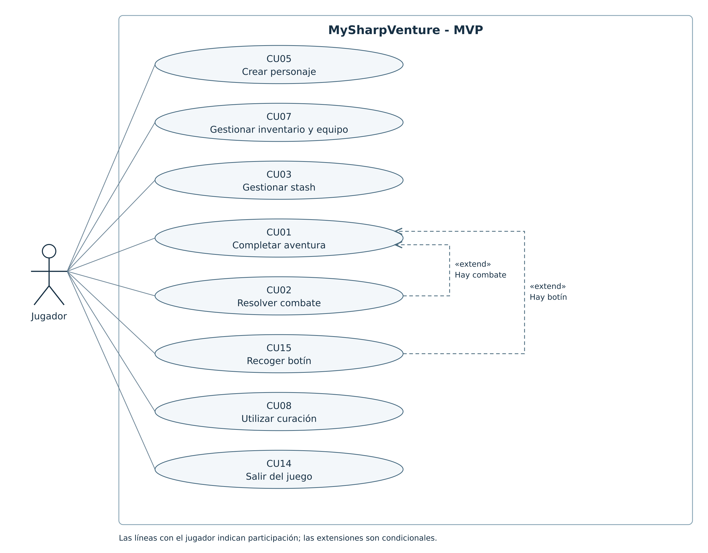

[Fuente editable](diagramas/13-casos-uso-mvp.mmd) · [Versión SVG](diagramas/13-casos-uso-mvp.svg)

*Figura 13. Ocho objetivos del jugador para la primera entrega. Combate y botín extienden la aventura cuando aparece el evento correspondiente; los alcances parciales se precisan en 13.2 y 13.7.*

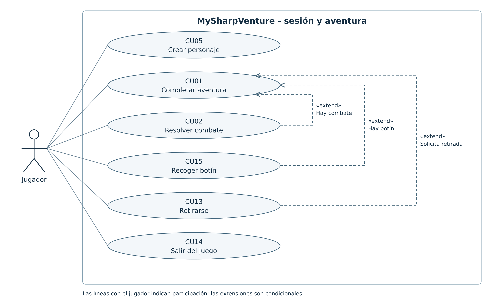

[Fuente editable](diagramas/14-casos-uso-aventura.mmd) · [Versión SVG](diagramas/14-casos-uso-aventura.svg)

*Figura 14. Diseño completo: Sesión y aventura. Las flechas de extensión apuntan al caso base CU01; las condiciones se explican en el catálogo.*

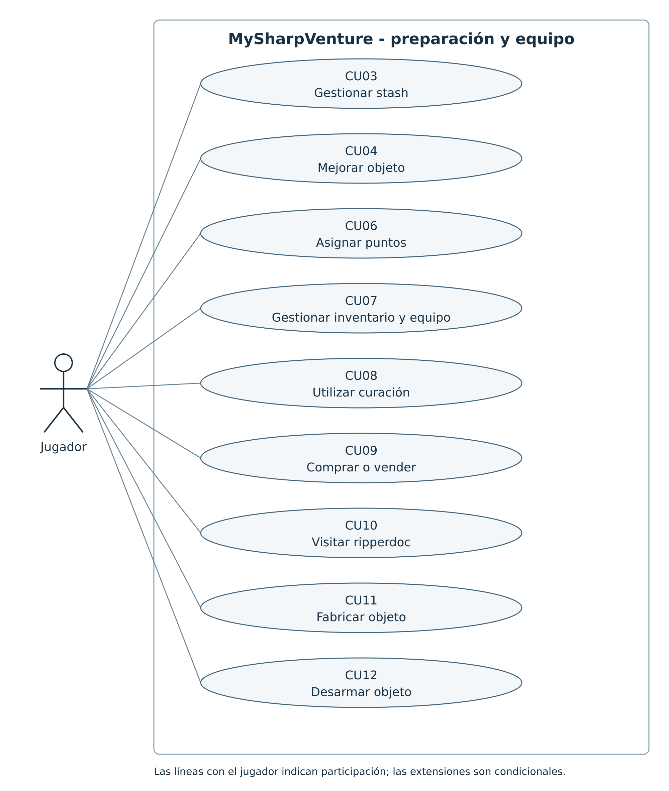

[Fuente editable](diagramas/15-casos-uso-preparacion.mmd) · [Versión SVG](diagramas/15-casos-uso-preparacion.svg)

*Figura 15. Diseño completo: Preparación y gestión. CU06, CU07 y CU08 también están disponibles durante la aventura cuando no hay combate, según sus precondiciones.*

### 13.2 Catálogo de casos

Todos los casos tienen como actor al Jugador. Sus precondiciones determinan en qué estado del juego están disponibles.

| ID | Objetivo | Precondición principal | Resultado y alternativas | Fase de entrega |
|---|---|---|---|---|
| CU01 | Completar una aventura | Personaje vivo y sin sobrepeso al iniciar. | Elige zona y resuelve cinco eventos; conserva recompensas y se recupera. Puede terminar por muerte o CU13. | MVP parcial: Watson, combate/hallazgo; sin retirada. |
| CU02 | Resolver combate y ejecutar acciones | Evento hostil activo. | Alterna turnos hasta victoria, muerte o retirada. Falta de recursos, fallos, estados y turnos perdidos siguen las reglas de combate. | MVP parcial: combate básico. |
| CU03 | Depositar o recuperar objetos | Preparación y base disponible. | Elige objeto y cantidad; se confirma transferencia persistente. Dinero e implantes instalados se rechazan. | MVP parcial: armas, munición y curación. |
| CU04 | Mejorar un objeto | Preparación, arma o cyberware mejorable y componentes suficientes. | Avanza un tier y consume componentes. Tier 5 o capacidad insuficiente rechazan la operación. | Posterior al MVP. |
| CU05 | Crear personaje | No existe un personaje activo. | Elige origen y recibe nivel, puntos, habilidad y equipo iniciales. | MVP parcial: orígenes y kit reducido. |
| CU06 | Asignar puntos | Personaje activo fuera del combate y puntos disponibles. | Aumenta atributo o desbloquea habilidad; valida límites, requisitos y dependencias. No hay redistribución. | Posterior al MVP. |
| CU07 | Gestionar inventario y equipo | Preparación o estado sin combate dentro de la aventura. | Consulta, equipa armas, cambia accesorios o quickhacks y descarta objetos. Implantes se gestionan mediante CU10. | MVP parcial: armas y consumibles. |
| CU08 | Utilizar curación | Objeto disponible y estado permitido. | Consume la cantidad y aplica el efecto; dentro de combate también consume una acción. | MVP. |
| CU09 | Comprar o vender objetos | Tienda de preparación o evento de comerciante. | Cambia dinero, objetos y stock según la operación; cantidades insuficientes o fondos insuficientes impiden completarla. | Posterior al MVP. |
| CU10 | Visitar al ripperdoc | Preparación. | Compra/vende cyberware o instala/extrae un implante. Verifica pertenencia, zona, capacidad y tarifa. | Posterior al MVP. |
| CU11 | Fabricar un objeto | Preparación, receta del catálogo y componentes disponibles. | Consume componentes y crea el resultado. Cyberware no es fabricable. | Posterior al MVP. |
| CU12 | Desarmar un objeto | Preparación y objeto de una familia admitida. | Destruye arma, accesorio o curación y entrega los componentes definidos. | Posterior al MVP. |
| CU13 | Retirarse de la aventura | Aventura activa, en combate o fuera de él. | Regresa inmediatamente, conserva el personaje y aplica las pérdidas; no obtiene recuperación completa. | Posterior al MVP. |
| CU14 | Salir del juego | Preparación. | Termina la sesión; lo transferido al stash permanece y el personaje no se guarda. | MVP. |
| CU15 | Recoger botín | Recompensa de combate o hallazgo disponible. | Elige objetos/cantidades, incluso con sobrepeso; al continuar abandona lo restante. | MVP: sin penalizaciones de peso. |

Los puntos de extensión de CU01 son el encuentro hostil, la recompensa disponible y la solicitud de retirada. CU02 se incorpora en el primero; CU15 en el segundo; CU13 en el tercero, solo en el desarrollo posterior. El evento puede tener combate, hallazgo o comerciante según la fase del producto. No se utiliza «include» para representar una relación que solo ocurre bajo una condición.

### 13.3 CU01 — Completar una aventura — diseño completo

**Disparador:** seleccionar «Ir de aventura».

1. El sistema verifica que exista un personaje vivo y que no tenga sobrepeso.
2. Muestra las tres zonas, sus organizaciones y rangos.
3. El jugador selecciona una zona; se prepara una aventura de cinco eventos y se realiza el sorteo de comerciante.
4. Se resuelve el evento actual. Si hay combate, se ejecuta CU02; si hay botín, CU15; si hay comerciante, puede ejecutarse CU09.
5. Después de un evento completado, se aplica la recuperación prevista una sola vez. Mientras quedan eventos, el jugador puede usar las operaciones habilitadas fuera del combate y avanzar manualmente.
6. Tras el quinto evento, regresa a preparación con sus pertenencias y recuperación completa.

**Alternativas:** sobrepeso impide iniciar; muerte elimina personaje y carga; retirada ejecuta CU13. Una retirada no se contabiliza como aventura completada.

### 13.4 CU02 — Resolver combate — diseño completo

**Disparador:** comenzar un evento hostil.

1. El sistema configura al enemigo a partir de zona, nivel, rol y equipamiento.
2. Presenta su intención aproximada y comienza el turno del jugador.
3. Procesa daño persistente, muerte, regeneración permitida y contadores.
4. El jugador elige una acción. Una selección inválida o sin recursos se informa sin gasto.
5. La acción válida consume sus costes y aplica acierto, defensas y efectos. Se comprueba el resultado.
6. Si el combate continúa, se procesa el turno enemigo con las mismas reglas de efectos y disponibilidad de acciones.
7. El ciclo se repite hasta victoria, muerte o retirada.

**Alternativas relevantes:** un fallo consume costes; Self-ICE bloquea sin devolver RAM; un arma bloqueada puede hacer perder la acción enemiga; un turno perdido sigue procesando efectos; Sandevistan modifica la disponibilidad de acciones; esperar permite continuar sin atacar.

**Postcondición:** al finalizar se eliminan estados temporales y se reinician enfriamientos. La victoria habilita el botín; la muerte o retirada aplican sus reglas de pérdida.

### 13.5 CU03 — Transferir con el stash — diseño completo

**Disparador:** seleccionar un depósito o retirada en preparación.

1. El sistema muestra los objetos y cantidades disponibles en el origen.
2. El jugador elige el objeto y, cuando corresponde, la cantidad.
3. El sistema valida pertenencia, cantidad y elegibilidad.
4. Si deposita un arma, informa que la desequipará, descargará y separará accesorios. Si deposita un cyberdeck suelto, informa la separación de quickhacks.
5. Se prepara una operación completa con todos sus objetos resultantes.
6. Se confirma la modificación en SQLite y se coordinan inventario y referencias de equipo.
7. La interfaz muestra las cantidades resultantes y el éxito de la operación.

**Alternativas:** dinero no admitido; implante todavía instalado requiere primero CU10; cantidad inválida se corrige; error de base impide informar éxito y conserva el estado anterior mientras la operación no esté confirmada.

**Postcondición:** los objetos transferidos tienen una sola ubicación válida. Lo depositado está disponible después de reiniciar; el personaje no se guarda.

### 13.6 CU04 — Mejorar un objeto — diseño completo

**Disparador:** elegir un arma o implante en la sección de mejora.

1. El sistema muestra el tier actual, el siguiente, sus estadísticas y los componentes requeridos.
2. Valida que exista un siguiente tier y que haya materiales suficientes.
3. Si el implante está instalado, calcula el nuevo uso total de capacidad.
4. Ante un exceso de capacidad, detiene la operación antes de consumir componentes.
5. Si la operación es válida, consume los componentes y sustituye la definición por la del siguiente tier, conservando la identidad de la instancia.
6. Actualiza equipo, estadísticas derivadas y carga; muestra el resultado.

**Postcondición:** el objeto avanzó exactamente un tier. No se cobró dinero ni se eligió una rama alternativa. Las referencias a la instancia siguen siendo válidas.

### 13.7 Recorrido de aceptación del MVP

1. CU05: iniciar, elegir uno de los tres orígenes y recibir el arma correspondiente, curaciones y munición del kit reducido.
2. CU07: consultar el inventario, equipar armas y comprobar cantidades. CU03 permite transferir objetos al stash desde preparación.
3. CU01: iniciar una aventura en Watson; se generan cinco eventos de combate o hallazgo.
4. CU02: ante un combate, mostrar la intención y alternar acciones del jugador y del enemigo. Seleccionar arma es gratuito; ataque, CU08 y recarga consumen su acción. Un rechazo previo por falta de recursos no consume la acción; un ataque ejecutado que falla consume sus costes.
5. CU15: al vencer o resolver un hallazgo, seleccionar botín y cantidades. Cuando quedan eventos se permite consultar y gestionar el equipo fuera del combate y continuar manualmente. El tiempo empleado en menús no cura.
6. Al completar los cinco eventos, regresar a preparación con el botín y la salud recuperada. Si muere, perder personaje y carga y volver a crear un personaje; conservar el stash.
7. CU03: depositar un arma la desequipa y descarga, guardando la munición por separado y mostrando el aviso. Depositar/retirar cantidades confirma cada operación; un error no se comunica como éxito.
8. CU14: salir, abrir de nuevo y verificar que el stash permanece y que el personaje no se recupera.

Las alternativas comerciales, de progresión, de implantes y de retirada descritas en los flujos completos no forman parte de este recorrido inicial.

## 14. Verificación prevista

### 14.1 Criterio de aceptación del MVP

La entrega del 02/12 requiere el ciclo de la sección 13.7, repetible en Windows 11, sin conexión y con persistencia correcta del stash. Los siguientes criterios delimitan qué debe estar comprobado; no se exige ejecutar los escenarios de sistemas posteriores.

| ID | Criterio obligatorio del MVP | Trazabilidad |
|---|---|---|
| PM01 | Crear los tres orígenes con sus armas y el kit reducido; navegar entre bienvenida y preparación. | RF01, CU05, CP01 parcial. |
| PM02 | Inspeccionar, equipar y descartar; no duplicar instancias; elegir arma sin consumir acción. | RF03–RF04, RF13, CU07, CP02 y CP07. |
| PM03 | Combatir contra un enemigo con intención aproximada; atacar, curarse, esperar y recargar; respetar turnos, costes y validaciones. | RF10–RF13, RF18, RF28–RF29, RF38; CU02/CU08; CP12, CP20–CP21 parciales. |
| PM04 | Resolver cinco eventos en Watson, elegir botín/cantidades, avanzar manualmente y regresar; el tiempo de menú no cura. | RF08–RF09, RF15, RF27, RF36; CU01/CU15; CP25, CP32, CP35 parciales. |
| PM05 | Morir, perder personaje/carga, crear otro y recuperar solo lo previamente depositado. | RF07, RF16; CU03/CU05; CP05, CP09. |
| PM06 | Transferir cantidades, desequipar y descargar armas al depositar; conservar stash al reiniciar; informar fallos sin confirmar cambios incompletos. | RF07, RF37; CU03/CU14; CP05, CP28–CP29 parciales; RNF07. |
| PM07 | Crear objetos desde SQLite; iguales definiciones producen iguales estadísticas; rechazar relaciones inválidas sin vaciar el stash. | RF25, CP39, RNF07. |
| PM08 | Completar el recorrido en Windows 11 sin conexión, con textos en español, instrucciones y SDD coherente con la compilación entregada. | CP18 parcial, RNF01–RNF08. |

El catálogo CP01–CP39 contiene los escenarios del diseño completo. Su última columna delimita los obligatorios o parciales del MVP; los resultados de las demás partes permanecen como objetivos posteriores.

Las pruebas siguientes permanecen **pendientes de ejecución sobre el juego**. No representan cobertura medida ni funcionalidades ya terminadas.

| ID | Escenario | Resultado esperado | Fase de entrega |
|---|---|---|---|
| CP01 | Crear cada origen; RF01–RF02. | Nivel 1, atributos base 1, cinco puntos de atributo, un punto de habilidad, habilidad gratuita y kit correcto. | MVP parcial: origen, arma y kit reducido; puntos posteriores. |
| CP02 | Equipar una cuarta arma Person o segunda Bot; RF04. | Rechazo sin duplicación ni pérdida de objetos. | MVP parcial: límite del jugador. |
| CP03 | Instalar segundo implante en una zona o exceder capacidad; RF05. | Operación impedida sin cobro ni cambio de equipo. | Posterior al MVP. |
| CP04 | Iniciar aventura con sobrepeso; RF06. | Bloqueo y mensaje que permita reducir la carga. | Posterior al MVP. |
| CP05 | Depositar y reiniciar; RF07, RF37. | Se conserva el stash, no el personaje. Armas descargadas y elementos separados. | MVP: armas descargadas, munición separada y cantidades. |
| CP06 | Entrar a Dogtown en nivel 1; RF08. | Acceso permitido; enemigos mantienen el rango 13–20. | Posterior al MVP. |
| CP07 | Navegar entre armas sin ejecutar; RF12–RF13. | No se consume acción ni avanza el enemigo. | MVP. |
| CP08 | Recibir daño con diferentes cantidades de escudo; RF14. | Mitigación parcial, desgaste igual a lo evitado y menor protección al disminuir escudo. | Posterior al MVP. |
| CP09 | Morir después de depositar objetos; RF16. | Se pierde la carga del personaje y se conserva lo depositado. | MVP. |
| CP10 | Retirarse con armas sueltas/equipadas y accesorios; RF17. | Se pierden todas las armas y accesorios instalados; los accesorios sueltos permanecen. | Posterior al MVP. |
| CP11 | Retirarse con dinero, reservas y cargadores; RF17. | Se pierden dinero y balas cargadas; se conserva munición de reserva y otros consumibles. | Posterior al MVP. |
| CP12 | Quedar sin arma o con brazos desactivados; RF18. | Ataque básico con stamina; esperar si no puede pagarse. | MVP parcial: ataque sin arma y espera; brazos/stamina posteriores. |
| CP13 | Mejorar arma o implante; RF20. | Avanza un tier con componentes y sin dinero; tier 5 rechaza otra mejora. | Posterior al MVP. |
| CP14 | Desarmar cada familia; RF21. | Solo armas, accesorios y curación; se destruye el objeto y se entregan componentes. | Posterior al MVP. |
| CP15 | Comprar en ambos tipos de tienda; RF22. | Precio y stock correctos; cyberware no aparece en comercio común. | Posterior al MVP. |
| CP16 | Instalar accesorio incompatible; RF23. | Rechazo sin cambios. | Posterior al MVP. |
| CP17 | Consultar Power, Tech y Smart; RF24. | Etiquetas descriptivas, sin exigir efectos especiales. | Posterior al MVP. |
| CP18 | Recorrer el ciclo completo en Windows 11; RNF01. | Creación, aventura, preparación, muerte/retirada y persistencia funcionan. | MVP parcial: ciclo de 1.3, sin retirada. |
| CP19 | Fabricar con receta válida; RF19. | Se consumen los componentes definidos y se obtiene el objeto; cyberware no es fabricable. | Posterior al MVP. |
| CP20 | Recargar parcialmente con reserva insuficiente; RF29. | Se utiliza la reserva disponible sin superar capacidad ni perder las balas previas. | MVP. |
| CP21 | Ejecutar ataque fallido o hackeo bloqueado; RF38. | Se consumen los costes; una falta previa de recursos no consume nada. | MVP parcial: ataques/recursos básicos; hackeos posteriores. |
| CP22 | Activar Sandevistan; RF31. | Tras activarlo queda una acción; enemigo pierde sus acciones y procesa efectos; enfriamiento de cuatro turnos propios. | Posterior al MVP. |
| CP23 | Aplicar Fallo de cyberware como primer y segundo hackeo contra Self-ICE; RF32. | El primero queda bloqueado; después puede desactivar la protección y otros efectos. | Posterior al MVP. |
| CP24 | Desactivar y reactivar un bono de máximo; RF32. | Recalcula y limita el recurso; recuperar el máximo no genera curación gratuita. | Posterior al MVP. |
| CP25 | Permanecer o navegar en pausa; RF27, RF34. | No añade recuperación; los tres turnos entre eventos se aplican una sola vez. | MVP parcial: menús no curan; recuperación por turnos posterior. |
| CP26 | Cerrar combate con estados y enfriamientos activos; RF34. | Se limpian y reinician; los valores de recursos no se rellenan salvo regreso exitoso. | Posterior al MVP. |
| CP27 | Gastar puntos sobre límites o sin dependencia; RF33. | Rechazo sin gasto; máximo de atributo 10 y de personaje 20; no hay recompra de habilidad. | Posterior al MVP. |
| CP28 | Retirar parte de una pila y provocar un fallo de escritura; RF37. | La operación rechazada conserva cantidades y referencias anteriores. | MVP. |
| CP29 | Depositar arma con accesorios y munición; RF37. | Una transferencia lógica guarda por separado todas las cantidades correctas. | MVP parcial: arma y munición; accesorios posteriores. |
| CP30 | Intentar depositar dinero o implante instalado; RF07, RF26. | Dinero rechazado; implante requiere extracción previa con ripperdoc. | Posterior al MVP. |
| CP31 | Mejorar implante instalado que excedería capacidad; RF05, RF20. | Mejora bloqueada antes de gastar componentes. | Posterior al MVP. |
| CP32 | Generar aventuras con sorteo controlado; RF09. | Siempre cinco eventos; cero o un comerciante; la prueba estadística evalúa el sorteo por aventura. | MVP parcial: cinco combates/hallazgos; sorteo comercial posterior. |
| CP33 | Gestionar cuatro quickhacks e intentar un quinto; RF30. | Cuatro permitidos; quinto rechazado; cambio fuera del combate. | Posterior al MVP. |
| CP34 | Aplicar Reboot Optics y ejecutar un hackeo; RF30, RF38. | Precisión física bajo 10 %; quickhack no realiza esa tirada. | Posterior al MVP. |
| CP35 | Elegir cantidades de botín y continuar; RF36. | Solo se añaden las elegidas; el resto deja de estar disponible. | MVP. |
| CP36 | Comprar, vender y regresar; RF35. | Stock limitado, fondos coherentes y reposición de tiendas de preparación. | Posterior al MVP. |
| CP37 | Consultar el siguiente evento varias veces; RF27. | La previsión se conserva y no cambia por volver a abrir el menú. | Posterior al MVP. |
| CP38 | Medir peso de arma, reserva, accesorios e implantes; RF06. | Cada elemento se cuenta una vez; dinero e implantes instalados no pesan. | Posterior al MVP. |
| CP39 | Cargar catálogo con relaciones inválidas; RF25, RNF07. | Error explícito; no se instancian objetos incoherentes ni se vacía el stash. | MVP: relaciones del catálogo reducido. |

### 14.2 Estrategia de pruebas

**Antes del 02/12:** comprobar las reglas del combate básico, cantidades y transferencias; integrar recorridos manuales de Watson, muerte/reinicio y reapertura del stash. Se hará una comprobación temprana de arranque en Windows 11 durante M01 y la aceptación integral durante M05. La reserva M06 se destina a defectos pendientes. Todas estas verificaciones están planificadas, no realizadas sobre el juego.

**Después del MVP:** la estrategia siguiente se extiende a los sistemas que se incorporen:

Las reglas puras de daño, costes, límites, peso y progresión se comprobarán sin consola. La selección aleatoria utilizará una fuente controlable para reproducir los escenarios; no se considerará un fallo que tres aventuras reales consecutivas no contengan comerciante.

Las pruebas de persistencia utilizarán una base temporal y cubrirán transferencias compuestas, cantidades, errores, reapertura y claves externas. Los recorridos manuales verificarán navegación, mensajes, pausas y uso del programa en ambas plataformas de trabajo.

Los datos de balance deberán permitir comparar partidas con los tres orígenes, el acceso inicial a Watson, el uso de cyberdeck y Sandevistan y el valor de mejorar frente a comprar o fabricar. Estas comprobaciones ajustan los parámetros; no sustituyen las pruebas de reglas.

## 15. Plan de trabajo y Gantt

### 15.1 Plazo y disponibilidad

- Una persona, con inicio de desarrollo el **lunes 16 de noviembre de 2026**.
- **Cuatro horas por día, de lunes a sábado: 24 horas por semana completa**.
- Entrega del MVP: **miércoles 2 de diciembre de 2026**.
- Se planifica terminar el trabajo el **martes 1 de diciembre**. No se utilizan posibles horas del día de entrega para justificar el alcance.
- Del 16/11 al 01/12 hay **14 jornadas y 56 horas disponibles**: 24 h la primera semana, 24 h la segunda y 8 h la última.
- Se asignan **48 h** a implementación, integración, pruebas y empaquetado, y **8 h** a reserva de correcciones.
- Domingo sin trabajo planificado. El calendario utiliza la disponibilidad de lunes a sábado; cualquier ausencia requiere revisar la distribución de tareas.
- Las actividades son secuenciales: no se asigna desarrollo paralelo a una sola persona. Las estimaciones no son horas ya ejecutadas.

**Análisis y documentación.** Estas actividades se realizaron antes del inicio del desarrollo y concluyen con la emisión del SDD el 14/11. El esfuerzo previo no fue registrado en horas y no forma parte de las 56 h de implementación.

M05 destina ocho horas a pruebas, correcciones, empaquetado e instrucciones de ejecución. La revisión de coherencia documental acompaña la implementación y el cierre del entregable.

### 15.2 Actividades y Gantt

| ID | Actividad | Horas | Jornadas | Inicio | Fin | Depende de |
|---|---|---:|---:|---|---|---|
| M01 | Entorno, estructura y navegación | 4 | 1 | 16/11/2026 | 16/11/2026 | SDD disponible |
| M02 | Combate e inventario básicos | 20 | 5 | 17/11/2026 | 21/11/2026 | M01 |
| M03 | Watson, eventos, botín y muerte | 8 | 2 | 23/11/2026 | 24/11/2026 | M02 |
| M04 | Catálogo SQLite y stash | 8 | 2 | 25/11/2026 | 26/11/2026 | M03 |
| M05 | Pruebas, correcciones y empaquetado | 8 | 2 | 27/11/2026 | 28/11/2026 | M04 |
| M06 | Reserva de estabilización | 8 | 2 | 30/11/2026 | 01/12/2026 | M05 |
| **Total** | **48 h de trabajo planificado + 8 h de reserva** | **56** | **14** | **16/11/2026** | **01/12/2026** | |

M01 incluye configurar el proyecto, el modelo mínimo, la navegación y una prueba temprana de arranque en Windows 11. M02 utiliza definiciones de prueba compatibles con el catálogo para no bloquear el combate; M04 conecta el catálogo definitivo reducido y la persistencia. Esas definiciones de prueba no sustituyen el requisito de cargar los objetos desde SQLite en la entrega.

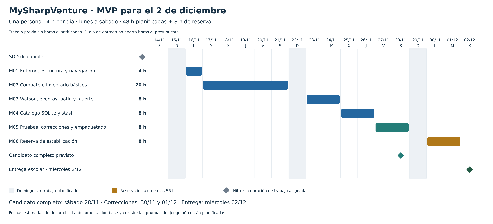

[Fuente editable](diagramas/16-gantt.mmd) · [Versión SVG](diagramas/16-gantt.svg)

*Figura 16. Cronograma del MVP. La tabla indica el último día trabajado; las barras Mermaid usan el inicio del día siguiente como fin exclusivo. La emisión del SDD y la entrega son hitos sin horas de desarrollo asignadas.*

### 15.3 Hitos verificables

| Hito | Fecha prevista | Resultado |
|---|---|---|
| SDD disponible | 14/11/2026 | Documento de diseño emitido antes del desarrollo. Esfuerzo previo sin registro horario. |
| Combate e inventario básicos | 21/11/2026 | Acciones, recarga y equipamiento integrados para los tres orígenes. |
| Ciclo de Watson | 24/11/2026 | Cinco eventos, botín, regreso y muerte conectados. |
| Persistencia integrada | 26/11/2026 | Catálogo reducido y stash recuperable después de cerrar y abrir. |
| Candidato completo | 28/11/2026 | MVP integrado, comprobado en Windows 11 y empaquetado, sujeto a correcciones de la reserva. |
| Cierre de estabilización | 01/12/2026 | Correcciones pendientes resueltas y paquete listo para entregar. |
| Entrega escolar | 02/12/2026 | Presentación del MVP y documentación. No se cuentan horas de desarrollo ese día. |

Los hitos futuros son objetivos de planificación; no acreditan funciones ya terminadas. Las comprobaciones de cada módulo se hacen durante su implementación. M05 concentra la aceptación integral y M06 absorbe errores o desvíos.

### 15.4 Control del alcance

La reserva tiene prioridad para completar y estabilizar PM01–PM08. Las funciones adicionales solo se incorporan cuando el MVP supera sus comprobaciones y queda tiempo disponible. Cada incorporación debe contar con su validación y estar reflejada en el entregable.

Los sistemas posteriores mantienen su especificación funcional. Su orden y estimación se planifican a partir del avance real del MVP.

## 16. Criterios de diseño y balance

### 16.1 Criterios técnicos

| Criterio | Aplicación |
|---|---|
| Entorno local | Un jugador, sin conexión ni servicios de autenticación. Desarrollo en Linux y validación en Windows 11. |
| Separación de responsabilidades | La interfaz presenta información y recibe entradas; el dominio aplica reglas; los repositorios administran SQLite. |
| Persistencia delimitada | El stash guarda cantidades por definición. Personaje, equipo activo, recursos y combate permanecen en memoria. |
| Datos de contenido | Las definiciones de objetos se cargan desde el catálogo. Cada modelo y tier tiene estadísticas deterministas. |
| Integridad de operaciones | Las validaciones preceden al gasto; las transferencias de stash se confirman mediante transacciones y coordinación del estado en memoria. |
| Desarrollo por alcance | El MVP implementa el subconjunto de 1.3. Los sistemas posteriores utilizan el modelo completo sin ampliar el compromiso del 02/12. |
| Verificación | Los criterios PM01–PM08 y la trazabilidad RF/CU/CP determinan la aceptación del MVP. |

### 16.2 Configuración de balance

Las reglas funcionales y los límites del sistema están establecidos en las secciones anteriores. Los valores numéricos de daño, curación, costes, probabilidades y recompensas se almacenan como configuración de contenido y se calibran durante las pruebas.

El MVP requiere configurar el combate básico, las tres armas iniciales, munición, curación y el pool de Watson. Los parámetros de los sistemas posteriores se incorporan con cada módulo.

| Grupo | Datos que deben configurarse | Restricciones del sistema |
|---|---|---|
| Recursos | Máximos base, crecimiento, regeneración y costes por acción. | Salud, escudo, stamina y RAM; tres turnos de recuperación entre eventos; tiempo de menú sin efecto. |
| Escudo | Curva de mitigación, coeficientes y redondeo. | Protección parcial y dependiente del escudo restante; desgaste igual a la cantidad evitada. |
| Ataques | Daños por variante/tier, precisión, críticos y costes de stamina. | Estadísticas deterministas; fallar consume recursos; sobrepeso no aumenta balas. |
| Estados y quickhacks | Magnitudes, duración, RAM, reducción posterior de Self-ICE y probabilidades permitidas. | Aplicación inmediata; ejecución instantánea de coste alto; Reboot Optics bajo 10 %. |
| Cyberware | Costes de capacidad, efectos adaptados y alternativas adicionales de catálogo. | Un implante por zona; sistema operativo exclusivo; cuatro quickhacks por deck; Sandevistan de cuatro turnos. |
| Habilidades | Nombres, bonificaciones, umbrales de atributo y grafo concreto. | Quince, tres por atributo, un punto por habilidad, compra única y al menos una dependencia por árbol. |
| Experiencia | Recompensas y tabla de umbrales. | Nivel 20 máximo; uno de cada tipo de punto por subida. |
| Economía | Precios, tarifas, stock, recetas, rendimientos de desarme. | Matriz de operaciones fija; mejoras sin dinero; cyberware solo en ripperdoc. |
| Peso | Pesos unitarios, crecimiento de capacidad y penalizaciones. | Dinero e implantes instalados sin peso; bloqueo de aventuras con sobrepeso. |
| Pools | Pesos de combates/hallazgos, perfiles de enemigo y recompensas. | Tres rangos fijos, cinco eventos y sorteo de comerciante 1/3 por aventura. |

Cada configuración de pruebas se identifica junto con el catálogo utilizado. El balance debe permitir comparar los tres orígenes y completar el recorrido de aceptación sin alterar las reglas de turnos, pérdidas ni persistencia.

## 17. Fuentes y glosario

### 17.1 Referencias

| ID | Fuente | Aplicación |
|---|---|---|
| F01 | [SQLite: Appropriate Uses For SQLite](https://www.sqlite.org/whentouse.html). | Base embebida para una aplicación local. |
| F02 | [SQLite: Foreign Key Support](https://www.sqlite.org/foreignkeys.html). | Claves externas y activación por conexión. |
| F03 | [SQLite Is Transactional](https://www.sqlite.org/transactional.html). | Atomicidad de las escrituras de la base. |
| F04 | [Cyberpunk 2077 Cyberware Database](https://nukesdragons.com/cyberpunk-2077/db/cyberware). | Nombres y familias de implantes de referencia. |
| F05 | [OMG: UML 2.5.1](https://www.omg.org/spec/UML/2.5.1). | Notación de clases y casos de uso. |
| F06 | [Mermaid: Class diagrams](https://mermaid.js.org/syntax/classDiagram.html). | Representación editable de relaciones entre clases. |
| F07 | [Mermaid: Entity Relationship Diagrams](https://mermaid.js.org/syntax/entityRelationshipDiagram.html). | Cardinalidades, claves y relaciones del modelo relacional. |
| F08 | [Mermaid: Use case diagrams](https://mermaid.js.org/syntax/usecase.html). | Fuentes editables de los diagramas de casos de uso. |

Las referencias de SQLite se consultaron el 13/11/2026 y las de modelado el 14/11/2026. Las reglas de combate, pérdidas, progresión y economía pertenecen a MySharpVenture y adaptan la ambientación al juego de terminal por turnos.

### 17.2 Glosario

| Término | Significado en este proyecto |
|---|---|
| Aventura o expedición | Secuencia de cinco eventos de una zona seleccionada. |
| Evento | Combate, hallazgo o comerciante. |
| Stash | Depósito persistente y compartido entre personajes. |
| Catálogo | Definiciones y estadísticas que permiten construir objetos. |
| Instancia | Objeto concreto en memoria, con identidad y estado de uso propios. |
| Tier | Calidad de arma o cyberware, del 1 al 5. |
| Atributo | Inteligencia, Fuerza, Agilidad, Habilidad técnica o Cool. |
| Habilidad / Perk | Desbloqueo del árbol comprado una vez o concedido por origen. |
| Nivel del árbol | Profundidad o etapa de una habilidad; no es el nivel del personaje. |
| Cyberware | Implante equipado por zona corporal y sujeto a capacidad. |
| Cyberdeck | Sistema operativo que aporta RAM y permite configurar quickhacks. |
| Ripperdoc | Servicio de preparación para comerciar, instalar y retirar cyberware. |
| RAM | Recurso del cyberdeck usado por los quickhacks. |
| Stamina | Recurso usado por acciones físicas y recuperado según el balance. |
| Enfriamiento | Tiempo medido en turnos hasta poder reutilizar una capacidad. |
| Rogue-lite | En este diseño, pérdida del personaje con conservación de objetos previamente depositados. |
| MVP | Primera versión jugable comprometida para el 02/12/2026, delimitada en 1.3. |
| Diseño completo objetivo | Especificación funcional del proyecto, implementada por fases. |
| Won’t del MVP | Sistema diseñado que queda fuera de la primera entrega. |
| Won’t del diseño completo actual | Ampliación futura no comprometida tampoco en el diseño objetivo vigente. |

